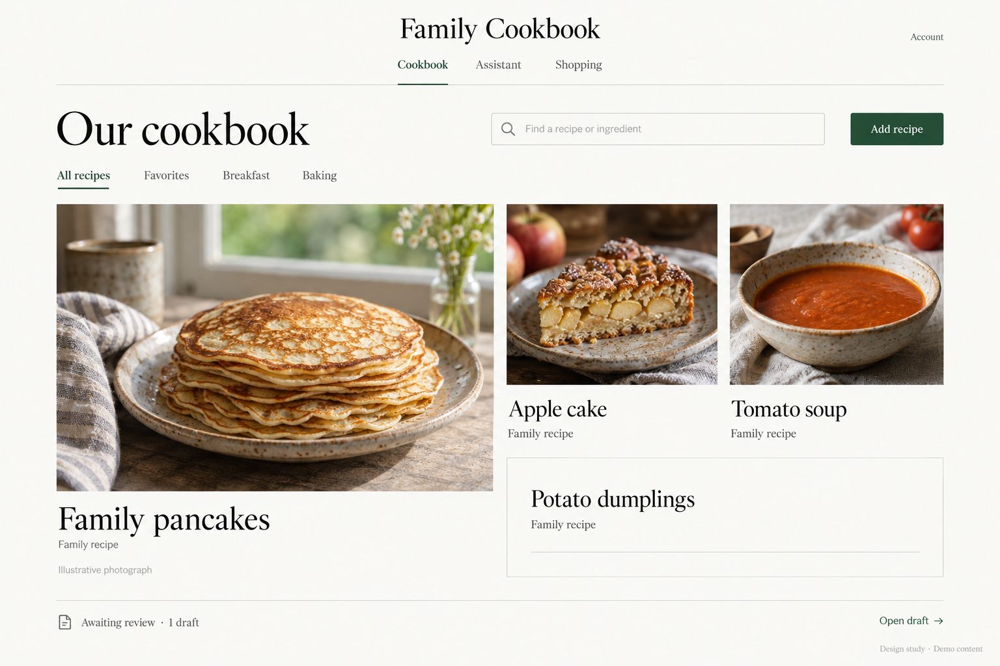
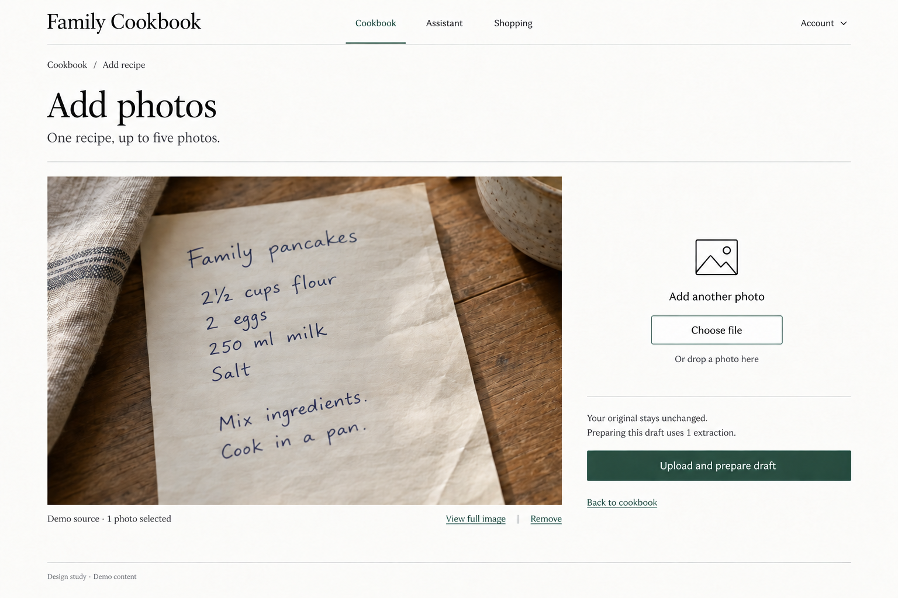
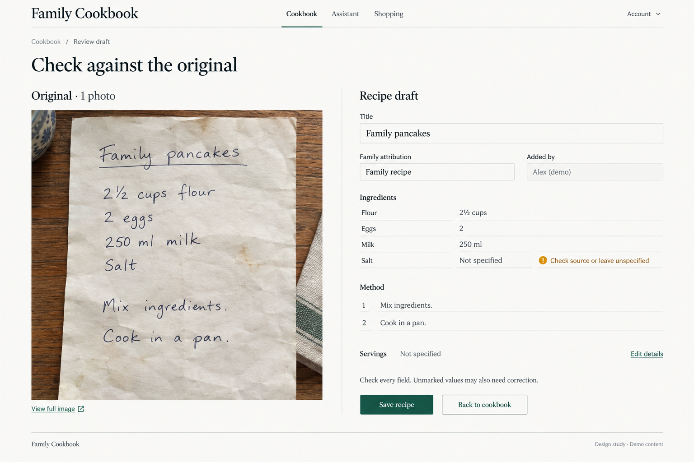
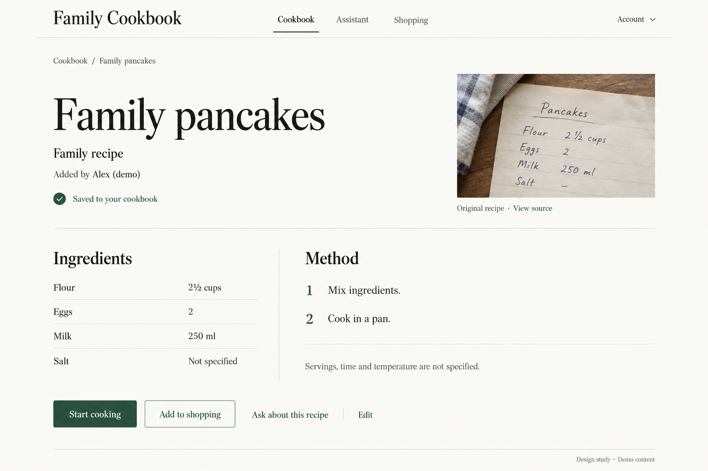
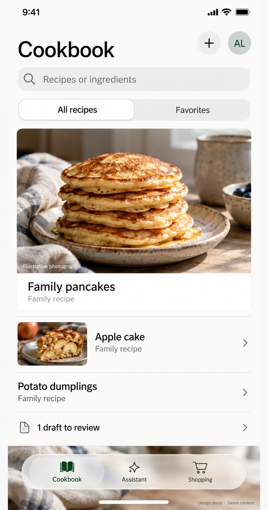
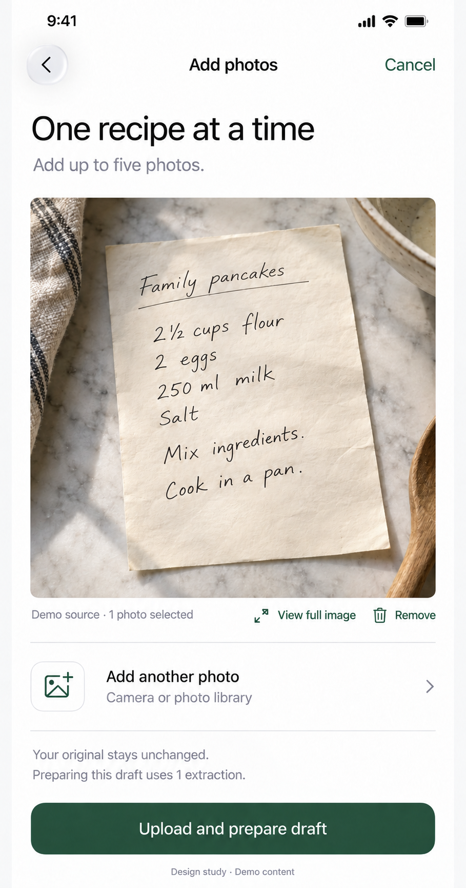
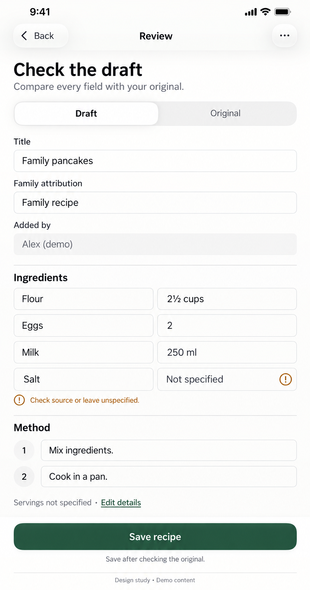
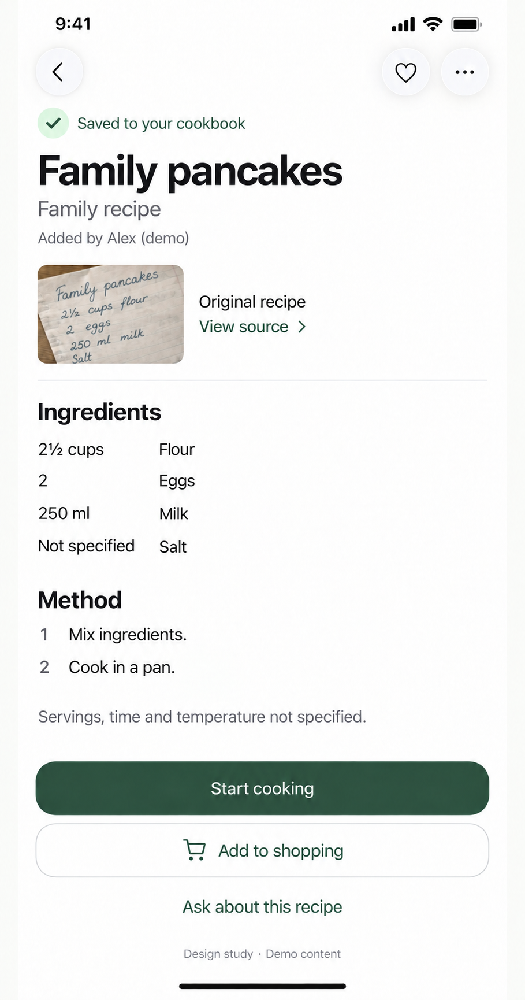
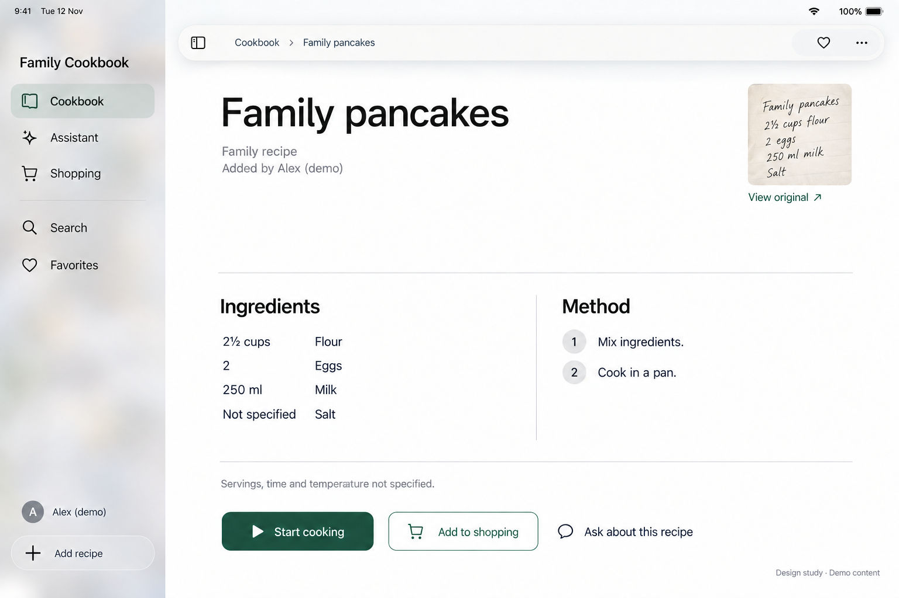
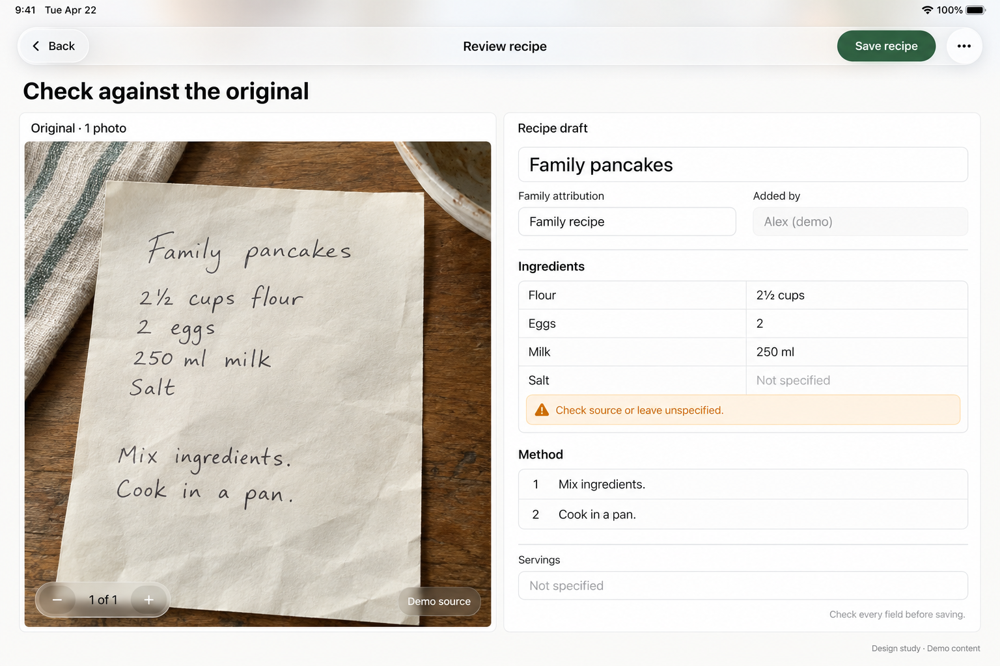

# Editorial cookbook and native Apple mockups

Historical design proposal v2, 2026-10-15. The developer rejected this direction, especially web. See the unapproved [v3 web studies](../editorial-web-v3/README.md) for the next focused iteration. These ten static studies remain for history; they are not visual authority. Application implementation remains paused.

Start with the [research, rationale and behavior brief](research-and-direction.md). It distinguishes current award evidence, established references, our recommendations, proposed imagery and remaining validation.

## Screen index

| Platform | Screen | Preview |
| --- | --- | --- |
| Web | Cookbook | [Open image](web-01-cookbook.png) |
| Web | Add photos | [Open image](web-02-add-photos.png) |
| Web | Review | [Open image](web-03-review.png) |
| Web | Saved recipe | [Open image](web-04-recipe.png) |
| iPhone | Cookbook | [Open image](iphone-01-cookbook.png) |
| iPhone | Add photos | [Open image](iphone-02-add-photos.png) |
| iPhone | Review | [Open image](iphone-03-review.png) |
| iPhone | Saved recipe | [Open image](iphone-04-recipe.png) |
| iPad | Recipe reading | [Open image](ipad-01-recipe.png) |
| iPad | Source and draft comparison | [Open image](ipad-02-review.png) |

The complete four-step flow is illustrated for desktop web and iPhone. Two additional iPad studies establish reading and comparison layouts. iPad index/import and narrow web adaptations are described in the brief, not separately illustrated.

## Web: Cookbook

## Web: Add photos

## Web: Review

## Web: Saved recipe

## iPhone: Cookbook

## iPhone: Add photos

## iPhone: Review

## iPhone: Saved recipe

## iPad: Recipe reading

## iPad: Source and draft comparison

## Scope and provenance

- All content is synthetic demo material. Private photos and recordings were not used.
- Dish photography is an optional editorial direction, pending a separate scope decision. The approved source model does not automatically include dish-cover uploads or AI-generated covers. Typography/source-based entries are the baseline without that decision.
- Liquid Glass here is a static visual approximation. Native material behavior, scrolling, reduced transparency and accessibility have not been validated by these images.
- Source paper differs visually between independent mockups. In the actual flow, the original must remain the same immutable file. Minor generated lettering and disabled-looking uploader fields are not new product decisions.
- See the brief for corrected quota terminology: the selected single image consumes one page, not an arbitrary per-draft or per-call unit.
- English artifact text follows repository instructions. Polish localization and large-text layouts remain to be reviewed.
- [Generation and revision prompts](prompts/) are retained. [provenance.json](provenance.json) records source outputs and [manifest.json](manifest.json) records final dimensions, hashes and prompt paths.
- No application code or implementation task status changed. T03 and T09 remain open with their existing blockers; both readiness gates remain closed.

