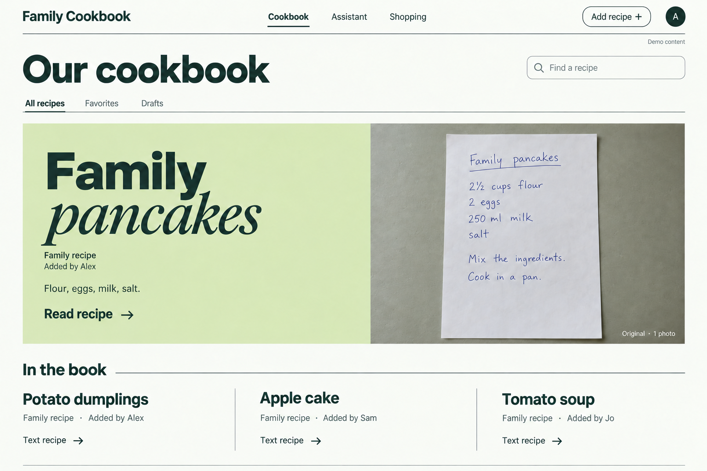
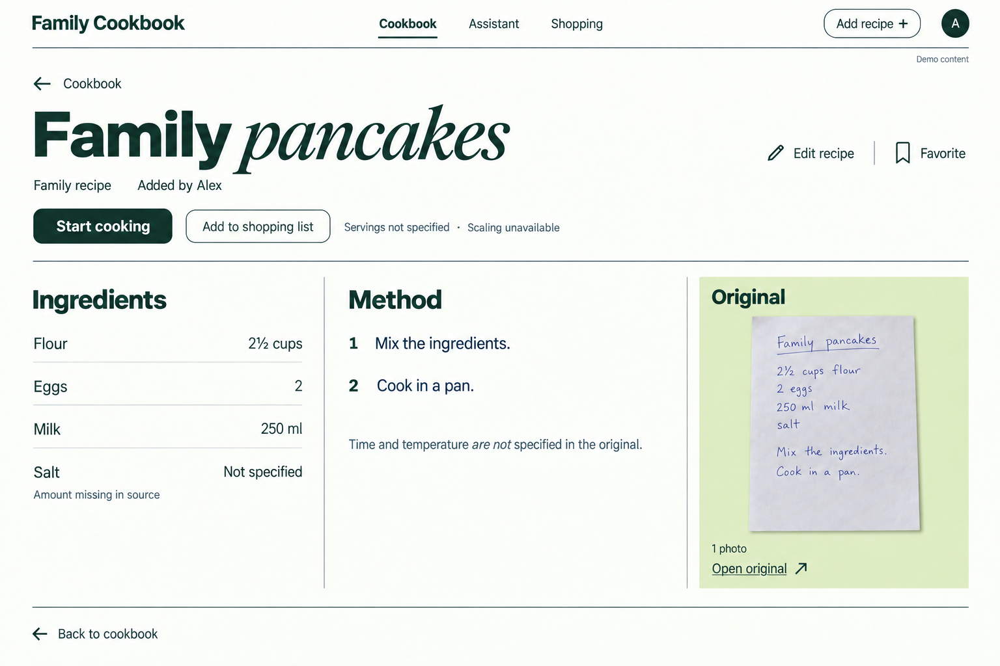
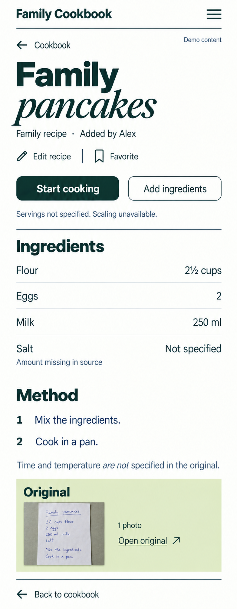

# Editorial web v3

Historical design proposal, 2026-10-15. Rejected by the developer as amateurish. Prepared with Impeccable and the built-in image-generation tool. No application code changed. The subsequent [Smakopas reference analysis](../smakopas-reference-analysis.md) records the new calibration reference and corrections in approach. This packet is not visual authority.

The developer rejected v2, especially web, and supplied KUKBUK and Kulinarna Stolica Polski as references. This focused round contains a cookbook index, a saved recipe and a narrow-web recipe study. It establishes a candidate reading language before extending it to import and review. It is not a replacement delivery of every native screen or the entire flow.

Read the [reference analysis](reference-analysis.md) for inspected sources, award dates, observations and evidence limitations.

## Cookbook

The asymmetrical opening uses a real content role: a recipe and its original. Text-only recipes are deliberate entries, with no empty image placeholders. Forest-green typography and celery fields carry the identity without requiring dish photography. The featured position is a layout study, not approval of a new curation feature; production ordering remains a product decision.

## Saved recipe

Cooking and shopping actions precede three aligned reading columns. Ingredients, method and source access fit in one desktop frame. Unknown salt quantity and servings remain explicit; no scaling, cooking time or temperature is invented.

## Narrow web

This is a static full-page composition, not a claim that the complete recipe fits in a phone's initial viewport. Reading reflows into one column; the source becomes a compact block after the method. The menu represents navigation to the same destinations. This is web, not the native iPhone design or evidence of Liquid Glass behavior.

## Design decisions and constraints

- Read mode for the index and saved recipe. Import and review remain Operate surfaces and must retain explicit editable fields and source comparison.
- Proposed palette: forest `#203D30`, celery `#DBE9BD`, paper `#FAFBF6`. These are direction targets, not measured raster pixels or approved production tokens.
- Strong geometric sans headings and UI, with a restrained italic serif contrast in the example title. Font selection and licensing remain open. The production rule must support arbitrary titles and Polish localization; it must not depend on the word “pancakes”.
- Family Cookbook is a working name, not approved branding. All people, records and original notes are synthetic demo content. Private evaluation photos and audio were not sent to the image generator.
- No dish-photo upload, generated cover, public feed, ratings, newsletter, map or voting feature is introduced.
- Source thumbnails are generated illustrations of the synthetic note, not byte-identical source assets. These mockups demonstrate placement and access only. Implementation must render the exact original asset, uncropped and unchanged, with a full-resolution viewer.
- The English text follows repository artifact rules. Long Polish titles, translated controls, text enlargement, keyboard operation, screen readers and every loading/error state still require separate validation.
- Raster inspection cannot establish WCAG compliance, hit-target sizes, responsive behavior, performance or native behavior. Motion was not prototyped.
- T03, T09, the implementation pause and both readiness gates are unchanged.

## Provenance and verification

The [manifest](manifest.json) records dimensions, hashes, exact prompt files and generation provenance. Prompts are also embedded in the final PNG files. The [visual review](visual-review.md) records the bounded review and corrections; it is not approval on the developer's behalf.

The next design checkpoint is evaluation of this visual language. Import/review and native adaptation should follow that feedback rather than treating these studies as an approved design system.
