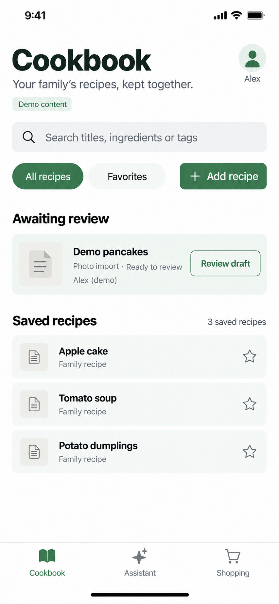
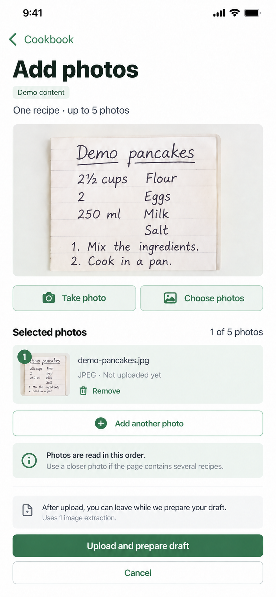
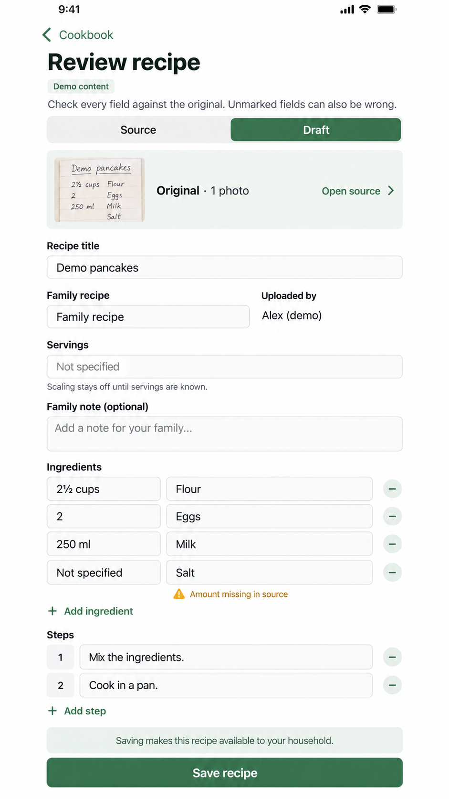
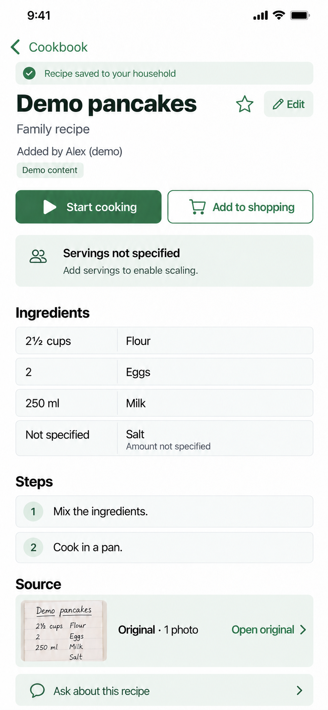
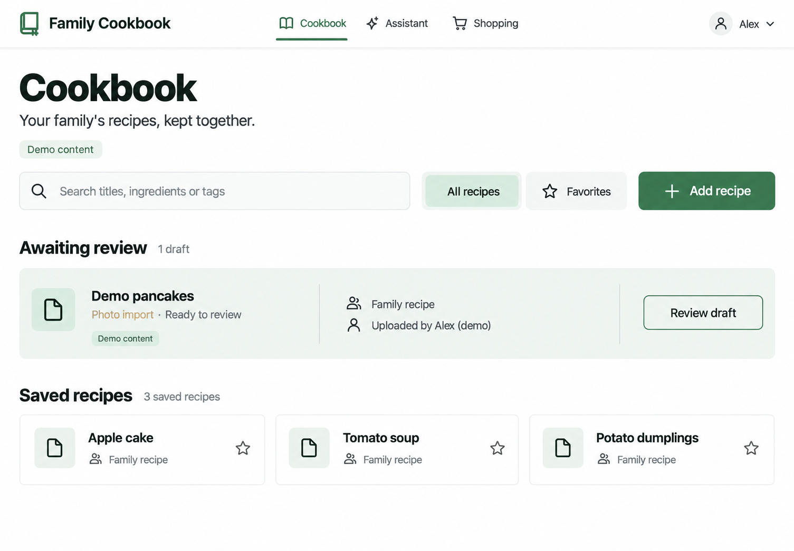
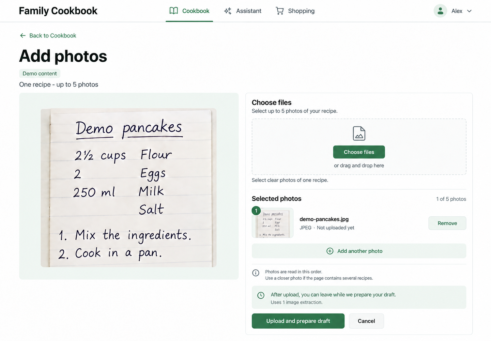
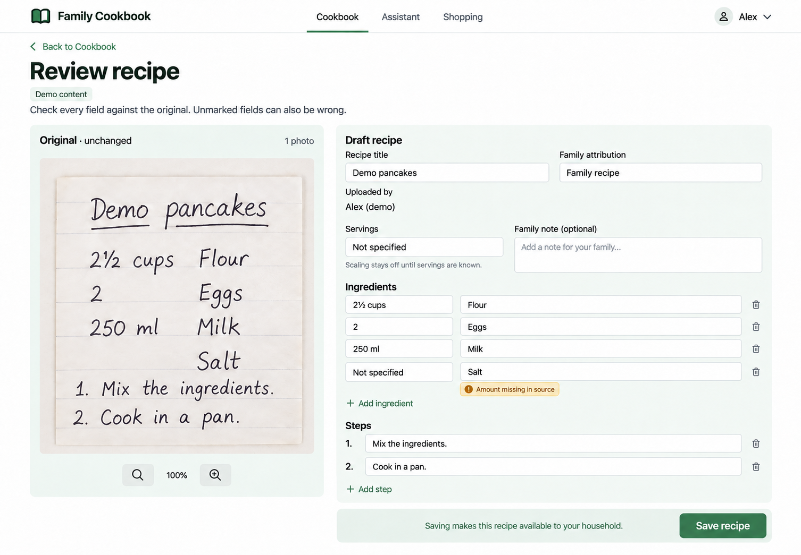
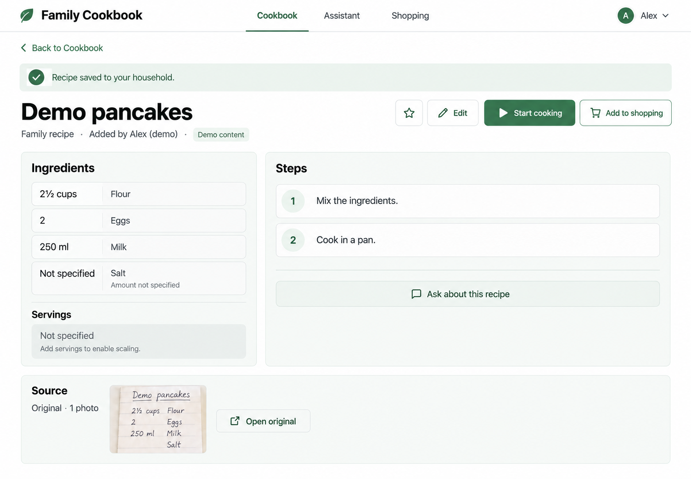

# Green capture flow

> Superseded visual proposal: the developer rejected these compositions on 2026-10-15. See the [editorial web and native Apple v2 proposal](../editorial-native-v2/README.md). Preserve the transition-state requirements below; these images are historical and are not current visual authority.

Eight high-fidelity mockups: Cookbook -> Add photos -> Review -> Saved recipe, on mobile and desktop. Prepared 2026-10-15. The developer selected the green direction; these complete-flow compositions are proposed for review. No application implementation is included.

## Screen index

| Step | Mobile | Desktop |
| --- | --- | --- |
| 1. Cookbook | [Open mobile](mobile-01-cookbook.png) | [Open desktop](desktop-01-cookbook.png) |
| 2. Add photos | [Open mobile](mobile-02-add-photo.png) | [Open desktop](desktop-02-add-photo.png) |
| 3. Review | [Open mobile](mobile-03-review.png) | [Open desktop](desktop-03-review.png) |
| 4. Saved recipe | [Open mobile](mobile-04-recipe.png) | [Open desktop](desktop-04-recipe.png) |

## Mobile

### Cookbook

### Add photos

### Review

### Saved recipe

## Desktop

### Cookbook

### Add photos

### Review

### Saved recipe

## Interaction brief

**Job and audience.** A family organizer turns a photographed recipe into a household recipe while retaining its original. Mode: Operate. Clarity of source, uncertainty and human approval is the focal point.

**Visual direction.** The selected reference is [Familiar recipe app](../../../.impeccable/mocks/decision/canon.png): white surface, dark green-black text, leaf-green actions and pale-green contextual surfaces. System sans type and familiar form controls remain primary. This is a design proposal, not a measured production token set or final brand. Book and leaf glyphs in headers are generic placeholders.

**Cookbook.** Search covers titles, ingredients and tags. Favorites are a filter, not a separate destination. Saved recipes and unapproved drafts remain separate. Profile opens household/account settings. Add recipe opens capture-method selection; choosing photos enters step 2. The four-screen packet focuses on that branch, not recording or manual-entry screens. The example draft illustrates the return-to-review path; a fresh import produces another draft only after processing.

**Add photos.** Select one to five ordered photos for one recipe. Native uses camera/library entry points; desktop uses a file chooser/drop area. Preview and remove are available before submission. When multiple images exist, provide Move earlier/Move later controls as well as drag ordering, with an announced new position. One selected image has no meaningful reorder action. Do not introduce automatic multi-recipe splitting or a source crop editor. No file-size limit is specified by this design. The extraction cost is visible before submitting.

**Upload and processing.** Upload and prepare draft first transfers bytes; a processing job begins only after upload acceptance. The user may leave after that boundary and later return through Cookbook. A loading indicator without numerical progress is appropriate when no measured progress exists. Never display invented percent complete or completion time. This transition is specified in the state table below; the eight primary mockups show the before-upload and ready-to-review endpoints.

**Review.** The original is unchanged. On desktop it occupies the left comparison pane; the right pane is the editable draft. On mobile Source/Draft changes views while retaining draft edits and scroll position. Full source view supports zoom and image-order navigation. Family attribution is editable; uploader identity is read-only metadata. Title, servings, optional note, ingredients and steps are editable. Unmarked fields still require review. Unknown amounts and servings may remain unknown on approval. Save recipe is the explicit human approval boundary and is disabled only during submission or a genuine validation/conflict condition, not solely because a source fact is absent.

**Saved recipe.** Show success only after confirmed save. The approved recipe keeps attribution and source access. Unknown servings have no active scaling controls. Start cooking opens the cooking view. Add to shopping opens a later ingredient review/confirmation flow; this click alone does not mutate the shared list. Ask about this recipe scopes the Assistant. Edit returns to a revision-aware editor. Native download and full cooking controls belong to the subsequent T20/T21 design scope, not to these four primary screen compositions.

## Transition and edge-state matrix

| State | Message and recovery | Persistence/approval boundary |
| --- | --- | --- |
| Empty cookbook | No saved recipes yet; Add recipe is the primary action. Keep draft status visible if a job exists. | Never render unapproved drafts as approved results. |
| Search has no results | No matching recipes; clear filters or change the query. | Existing recipes remain intact. |
| Cached/offline cookbook | Label cached content; allow available reading, explain why adding/editing needs a connection. | Do not promise web cold-start offline access. |
| Permission denied | Explain camera/library access and offer an allowed alternative or system-settings route. | Do not repeatedly trigger the permission prompt. |
| Invalid or excess images | Identify the affected file and allow replacement; keep other selected images. | One recipe, up to five images; supported codecs/size limits come from implementation findings. |
| Quota/storage unavailable | Name the exhausted resource and offer permitted alternatives, such as manual entry when allowed. | Do not claim failure consumed an extraction or erase sources. |
| Upload in progress | Uploading photo; keep this screen open until upload completes. | Do not promise accepted source persistence before transfer is acknowledged. |
| Upload interrupted | Upload did not finish; reconnect and retry. Retain selection while locally available. | No promise of local media survival after process termination. |
| Processing accepted | Upload complete; preparing draft. You can return to Cookbook. | Job can continue without this screen. |
| Processing failed | Original retained; Retry or Enter manually. | Retry of the same operation does not duplicate the recipe or allowance charge. |
| Ready to review | Ready to review; Open draft. | Still excluded from approved cookbook retrieval. |
| Unreadable/absent value | Identify the field; view source, correct it or retain Not specified. | Do not silently insert quantities, temperatures, time or servings. |
| Leave with unsaved edits | Explain which edits would be lost; Stay or Discard unsaved edits. | Do not imply durable auto-save of review edits without an approved contract. |
| Another member saved a revision | Explain the conflict; show current version and preserve the user's attempted input for comparison. | Never silently overwrite another member's accepted changes. |
| Save failed or outcome unknown | Save not confirmed; reconnect and verify/retry. Retain the entered draft while the view remains available. | No saved-success banner or duplicate recipe on uncertain outcome. |
| Membership revoked | Access ended; return to account/household entry. | No further protected source access, edit or save. |
| Save confirmed | Recipe saved to your household. | Remove this draft from Awaiting review; show the recipe among saved results. |

## Platform and accessibility handoff

- The mobile images use an iOS-like presentation as the representative compact composition. They are not separate Android screenshots. Android should adapt system Back, Material navigation/controls and 48dp touch targets; iOS should preserve edge-swipe Back, native controls and 44pt targets.
- Long mobile images are full-scroll design canvases. They do not claim all fields fit a single physical viewport. At narrow widths or large text, attribution/uploader and ingredient columns stack. Action labels wrap or move to separate rows rather than shrinking text.
- Body text, placeholders, status text and focus indicators need measured contrast in the implemented theme. Missing values use text and an icon as well as amber color. Green is not the only indication of state.
- Keyboard navigation follows visual order. Each ingredient amount, ingredient name and remove control needs a specific accessible label. Source zoom and image ordering must work without drag gestures. Source preview is an image, not a substitute for accessible editable text.
- A sticky action area must respect safe-area/keyboard insets and never obscure fields. Error announcements and submission status must be exposed to assistive technology. Reduce Motion uses immediate or short fade transitions.
- These artifacts follow the repository's English-content rule. Polish localization, long recipe titles, dynamic text sizes and dark appearance still need dedicated layout review. This packet does not claim WCAG or native-runtime acceptance.

## Evidence and limitations

All recipe content and handwritten source images are synthetic. No private `tests/assets` material was sent to image generation. The full source in photo selection and desktop review contains exactly the illustrated ingredients and two steps. Small source thumbnails show the upper portion only.

One batched visual correction pass removed an invented file-size limit, added missing steps to full synthetic source previews, corrected the mobile review layout, separated read-only uploader metadata, restored profile access, and made the mobile saved state/ingredient columns explicit. Final images were inspected as generated. There are no running product controls behind these raster mockups. Minor generated icon/typography differences are not new product decisions.

[manifest.json](manifest.json) records final dimensions, hashes and prompt provenance. Every image includes its final generation/edit prompt; original and correction prompts are retained in `prompts/`. Direction approval is recorded separately from approval of these eight compositions.

T03 remains blocked on physical-device persistence tests. T09 retains the capture-fidelity, missing representative recording and reference gaps. Both readiness gates remain closed. Mockups do not establish model accuracy, offline durability or task completion. No feature implementation was resumed.
