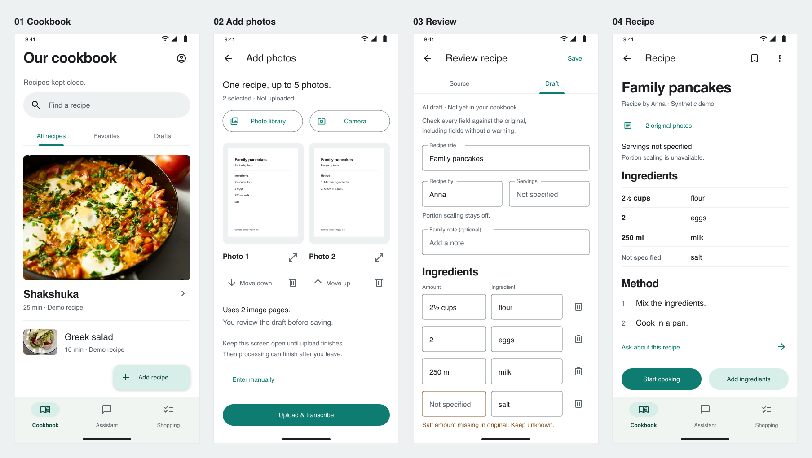

# Smakopas-based Android mockups

Static design proposal, 2026-10-16. Four main phone screens continue the Smakopas typography and restrained composition with Material navigation, controls and surfaces. This packet contains no application implementation or interactive prototype.

## Individual screens

Artboards use a 412 x 915 logical phone canvas and export as 824 x 1830 PNGs. Editable SVGs embed the fonts and source images.

| Screen | PNG | SVG |
| --- | --- | --- |
| Cookbook | [Open](android-01-cookbook.png) | [Vector](android-01-cookbook.svg) |
| Add photos | [Open](android-02-add-photos.png) | [Vector](android-02-add-photos.svg) |
| Review | [Open](android-03-review.png) | [Vector](android-03-review.svg) |
| Recipe | [Open](android-04-recipe.png) | [Vector](android-04-recipe.svg) |

The same review also has a [Source view](android-review-source.png) and a [lower form view](android-review-lower.png), with [Source SVG](android-review-source.svg) and [lower-form SVG](android-review-lower.svg). These show the unchanged original and the rest of the form at readable sizes, not additional product steps.

## Platform adaptation

Archivo remains the reading and title face. Roboto supplies Android control labels; icons are actual Material Symbols. The compact navigation bar has Cookbook, Assistant and Shopping. A single extended FAB creates a recipe. Capture and review use top app bars, Source / Draft tabs and outlined fields. Opaque surfaces and restrained tonal emphasis replace the Apple material treatment.

The two synthetic originals and imported Family pancakes recipe remain consistent with web and Apple studies: `2½ cups`, unknown salt quantity and unknown servings are preserved. No dish photo, time or temperature is added. English design text follows repository rules; Polish labels require later layout validation.

The [design brief](design-brief.md), [Material reference](material-reference.md), [credits](credits.md), [visual review](visual-review.md) and [manifest](manifest.json) record the decisions, provenance and verification limits. The [exporter](source/render.cjs) and [drawing instructions](source/artboards.cjs) create static artwork only.

These phone studies cover light appearance and standard text size. Native behavior, TalkBack, larger fonts, Dark Mode, keyboard handling, system Back, tablets and foldables remain separate validation/design work. No emulator or device test is claimed. User visual review is pending; T03, T09 and both readiness gates remain unchanged.
