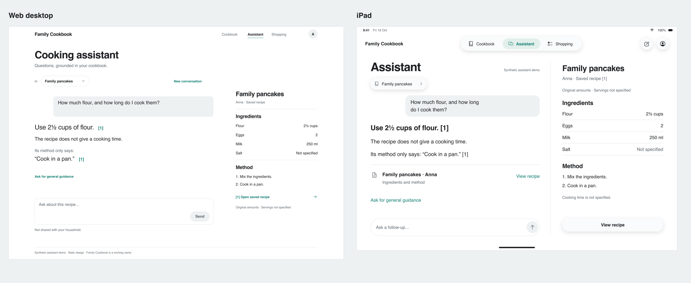
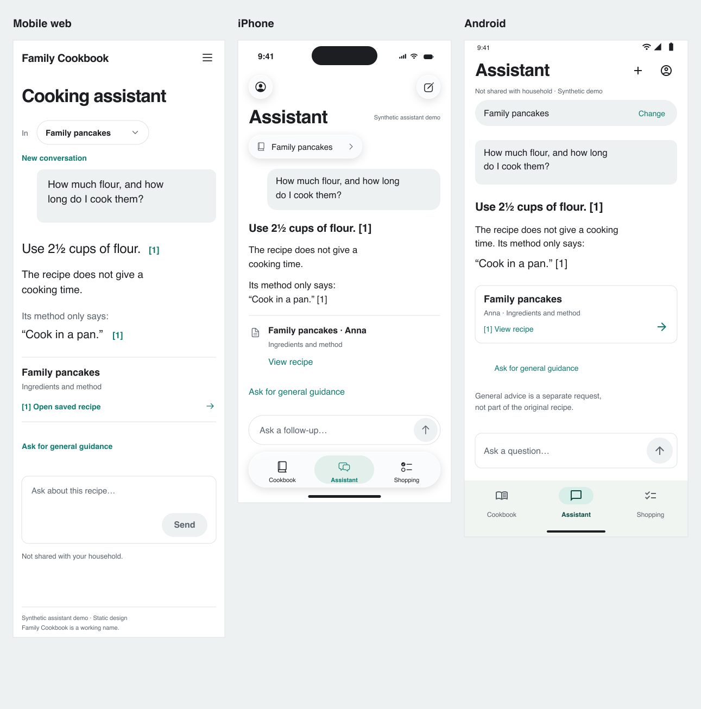

# Culinary assistant

Eighteen static proposals for desktop web, mobile web, iPhone, iPad and Android phone. The Smakopas v4 typography and simple composition continue, with a Liquid Glass projection on Apple controls and Material-style Android controls. All screens have PNG exports at 2x and SVG drawing sources. Awaiting user review; no application implementation.

## An answer with its recipe

The visible scope is Family pancakes. The response retains `2½ cups` and makes the missing cooking time explicit. A recipe reference supports the answer. General guidance is a separate request, not a fact silently added to Anna's recipe.

| Surface | Full-resolution PNG | SVG |
| --- | --- | --- |
| Desktop web | [Recipe answer](web-desktop-answer.png) | [Source](web-desktop-answer.svg) |
| Mobile web | [Recipe answer](web-mobile-answer.png) | [Source](web-mobile-answer.svg) |
| iPhone | [Recipe answer](iphone-answer.png) | [Source](iphone-answer.svg) |
| iPad | [Recipe answer](ipad-answer.png) | [Source](ipad-answer.svg) |
| Android phone | [Recipe answer](android-answer.png) | [Source](android-answer.svg) |

## Start a conversation

Two paths lead into the assistant: ask about a saved recipe, or name ingredients to use. The scope starts at the whole cookbook. Conversation privacy and typed input are explicit; the assistant has no microphone.

| Surface | Full-resolution PNG | SVG |
| --- | --- | --- |
| Desktop web | [Start](web-desktop-start.png) | [Source](web-desktop-start.svg) |
| Mobile web | [Start](web-mobile-start.png) | [Source](web-mobile-start.svg) |
| iPhone | [Start](iphone-start.png) | [Source](iphone-start.svg) |
| iPad | [Start](ipad-start.png) | [Source](ipad-start.svg) |
| Android phone | [Start](android-start.png) | [Source](android-start.svg) |

## Cook with ingredients

Flour, eggs and milk form a temporary list for this question. The assistant proposes the saved Family pancakes recipe, identifies salt as absent from that list and preserves its unknown amount. Ingredient presence does not establish sufficient quantities. `Review shopping additions` opens a separate review and explicit confirmation; nothing is added by receiving this response.

| Surface | Full-resolution PNG | SVG |
| --- | --- | --- |
| Desktop web | [Ingredient suggestion](web-desktop-meals.png) | [Source](web-desktop-meals.svg) |
| Mobile web | [Ingredient suggestion](web-mobile-meals.png) | [Source](web-mobile-meals.svg) |
| iPhone | [Ingredient suggestion](iphone-meals.png) | [Source](iphone-meals.svg) |
| iPad | [Ingredient suggestion](ipad-meals.png) | [Source](ipad-meals.svg) |
| Android phone | [Ingredient suggestion](android-meals.png) | [Source](android-meals.svg) |

The existing [shopping confirmation study](../smakopas-shopping-v4/README.md#confirm-recipe-additions) supplies a separate illustrative confirmation. Its ingredient choices are not automatically selected or excluded by this assistant scenario.

## Recovery states

| Surface | Full-resolution PNG | SVG |
| --- | --- | --- |
| Mobile web | [No matching saved recipe](web-mobile-no-match.png) | [Source](web-mobile-no-match.svg) |
| iPhone | [Assistant allowance reached](iphone-limit.png) | [Source](iphone-limit.svg) |
| Android phone | [Answer request failed](android-error.png) | [Source](android-error.svg) |

These are independent synthetic alternatives. They do not show actual account allowances, model results, full-cookbook retrieval evaluation or a working network request.

## Design record

- [Design brief and behavior boundaries](design-brief.md)
- [Visual review and validation limits](visual-review.md)
- [Assets and source provenance](credits.md)
- [Synthetic scenario](source/scenario.json)
- [Artifact hashes](manifest.json)

The screens depict intended controls and materials, not a native runtime, working conversation or accessible view hierarchy. Further interaction states and localization are documented in the brief. T03 and T09 remain open with their existing blockers; neither readiness gate changes.
