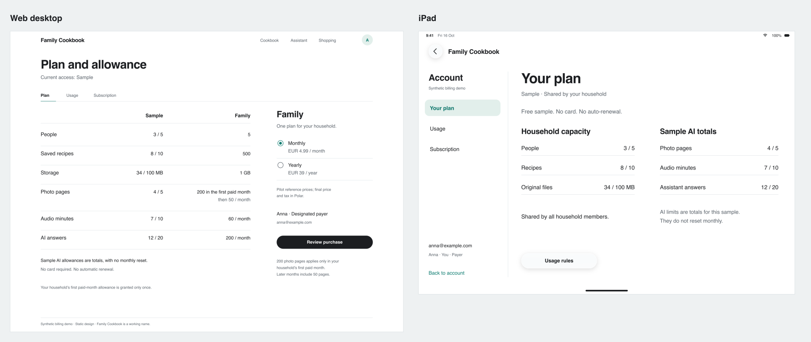
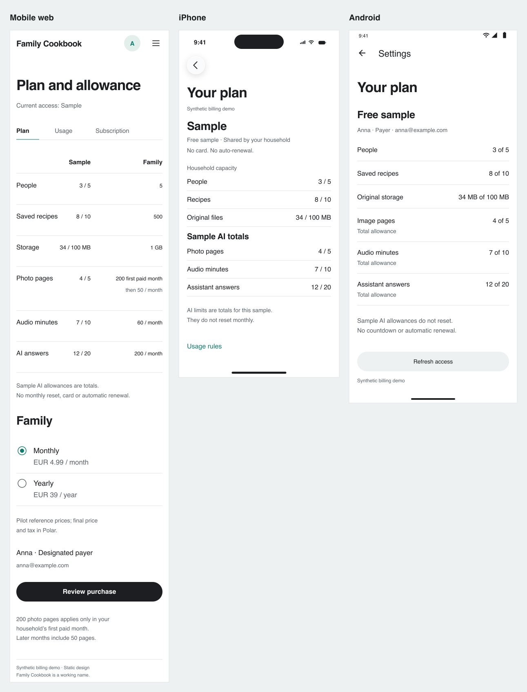
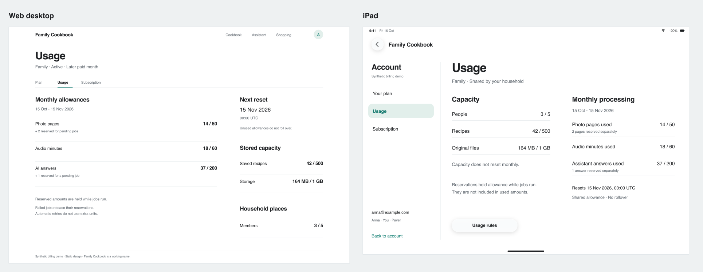
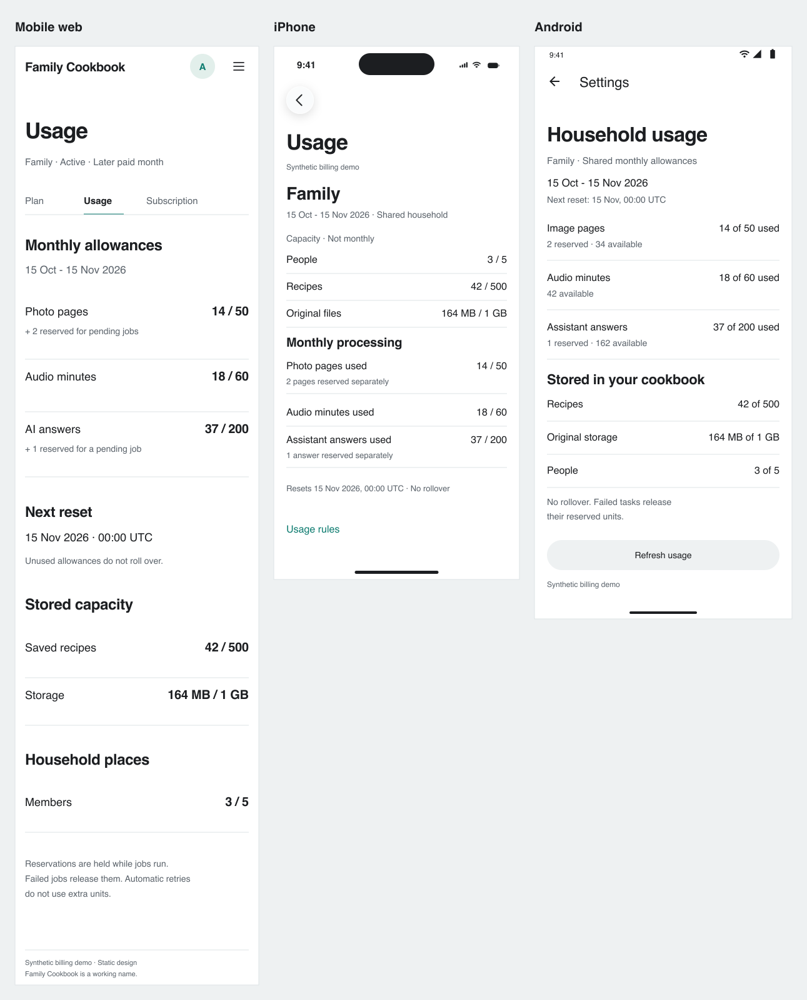

# Plans, allowances and subscriptions

Twenty-eight static proposals across desktop web, mobile web, iPhone, iPad and Android phone. Smakopas typography and simple composition continue, with Liquid Glass illustrated on Apple controls and opaque Material treatments on Android. Each screen has a 2x PNG and editable SVG drawing. Awaiting user review; no application implementation.

Polar is the sole purchase provider. Purchase and subscription management appear only on web. Native artwork shows current access, allowances and refresh without purchase links, QR codes, prices or external-checkout promotion.

## Plan and sample

The web comparison presents one Family plan with monthly or annual billing and the card-free sample. EUR 4.99/month and EUR 39/year are labelled pilot references, not current localized Polar offers. The native screens describe the current sample without an upgrade pitch. Sample AI allowances are one-time totals; saved recipes and storage are current capacity limits. The sample does not auto-renew.

| Surface | PNG | SVG |
| --- | --- | --- |
| Desktop web | [Plan](web-desktop-plan.png) | [Source](web-desktop-plan.svg) |
| Mobile web | [Plan](web-mobile-plan.png) | [Source](web-mobile-plan.svg) |
| iPhone | [Plan](iphone-plan.png) | [Source](iphone-plan.svg) |
| iPad | [Plan](ipad-plan.png) | [Source](ipad-plan.svg) |
| Android | [Plan](android-plan.png) | [Source](android-plan.svg) |

## Shared household usage

Monthly allowances are separate from saved-recipe/storage capacity. Used units and pending reservations are separate: 14 image pages used plus two reserved leaves 34 of 50 available; 37 answers plus one reserved leaves 162 of 200. The synthetic reset is 15 November at 00:00 UTC. The billing renewal date is separate, and annual billing still has monthly usage windows.

| Surface | PNG | SVG |
| --- | --- | --- |
| Desktop web | [Usage](web-desktop-usage.png) | [Source](web-desktop-usage.svg) |
| Mobile web | [Usage](web-mobile-usage.png) | [Source](web-mobile-usage.svg) |
| iPhone | [Usage](iphone-usage.png) | [Source](iphone-usage.svg) |
| iPad | [Usage](ipad-usage.png) | [Source](ipad-usage.svg) |
| Android | [Usage](android-usage.png) | [Source](android-usage.svg) |

## Active subscription and access

Anna is the current payer, Alex the administrator and Sam a member. All three share access. Web shows Anna's own purchase-management entries; native shows verified access and refresh. This later paid state is independent of the earlier sample and checkout alternatives.

| Surface | PNG | SVG |
| --- | --- | --- |
| Desktop web | [Subscription / access](web-desktop-subscription.png) | [Source](web-desktop-subscription.svg) |
| Mobile web | [Subscription / access](web-mobile-subscription.png) | [Source](web-mobile-subscription.svg) |
| iPhone | [Subscription / access](iphone-subscription.png) | [Source](iphone-subscription.svg) |
| iPad | [Subscription / access](ipad-subscription.png) | [Source](ipad-subscription.svg) |
| Android | [Subscription / access](android-subscription.png) | [Source](android-subscription.svg) |

## Archive after verified expiry

All 42 recipes, originals and three members remain. Reading, search, cooking, downloads, export and checking existing shopping items remain available. New recipes, uploads, edits, AI and shopping additions pause. Export and deletion do not require payment. The unpaid inactivity policy still applies; this is not lifetime hosting.

| Surface | PNG | SVG |
| --- | --- | --- |
| Desktop web | [Archive](web-desktop-archive.png) | [Source](web-desktop-archive.svg) |
| Mobile web | [Archive](web-mobile-archive.png) | [Source](web-mobile-archive.svg) |
| iPhone | [Archive](iphone-archive.png) | [Source](iphone-archive.svg) |
| iPad | [Archive](ipad-archive.png) | [Source](ipad-archive.svg) |
| Android | [Archive](android-archive.png) | [Source](android-archive.svg) |

## Purchase and recovery alternatives

The checkout review is an application-owned handoff study, not a cloned Polar form or a verified provider offer. It uses a separate eligible sample-state household with Anna as payer and no active or grace-covered subscription. Returning from checkout does not establish payment success. No real checkout or management action is executed.

| State | PNG | SVG |
| --- | --- | --- |
| Annual purchase review before Polar | [Desktop web](web-desktop-checkout.png) | [Source](web-desktop-checkout.svg) |
| Checkout return awaiting verification | [Mobile web](web-mobile-pending.png) | [Source](web-mobile-pending.svg) |
| Review stopping renewal | [Mobile web](web-mobile-cancel.png) | [Source](web-mobile-cancel.svg) |
| Renewal verified as off, access still active | [Mobile web](web-mobile-cancelled.png) | [Source](web-mobile-cancelled.svg) |
| Accepted next payer, waiting for eligibility | [Desktop web](web-desktop-payer-change.png) | [Source](web-desktop-payer-change.svg) |
| Only image-page allowance exhausted | [iPhone](iphone-limit.png) | [Source](iphone-limit.svg) |
| Verified temporary grace access | [iPad](ipad-grace.png) | [Source](ipad-grace.svg) |
| Refresh failed, current status unknown | [Android](android-refresh-error.png) | [Source](android-refresh-error.svg) |

Cancellation, verified expiry, temporary grace and a refresh error are distinct. Payer succession transfers no card or subscription, makes no automatic purchase and does not reset usage. A fixed grace duration or automatic refund-to-access rule is not invented. Non-payer account entry is already illustrated in the [household/account packet](../smakopas-household-v4/README.md).

## Design record

- [Behavior, remaining states and scope](design-brief.md)
- [Visual review and validation limits](visual-review.md)
- [Assets and provenance](credits.md)
- [Shared synthetic scenario](source/scenario.json)
- [Artifact hashes](manifest.json)

These drawings implement no checkout, subscription management, cancellation, quota enforcement, access refresh or payer change. T03 and T09 retain their existing blockers; neither readiness gate changes.
