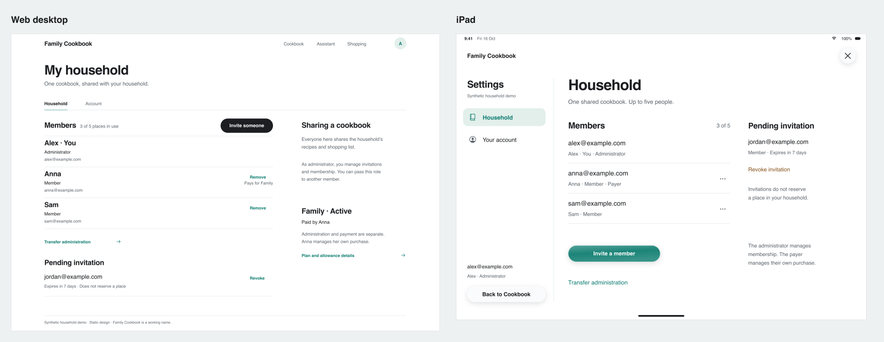
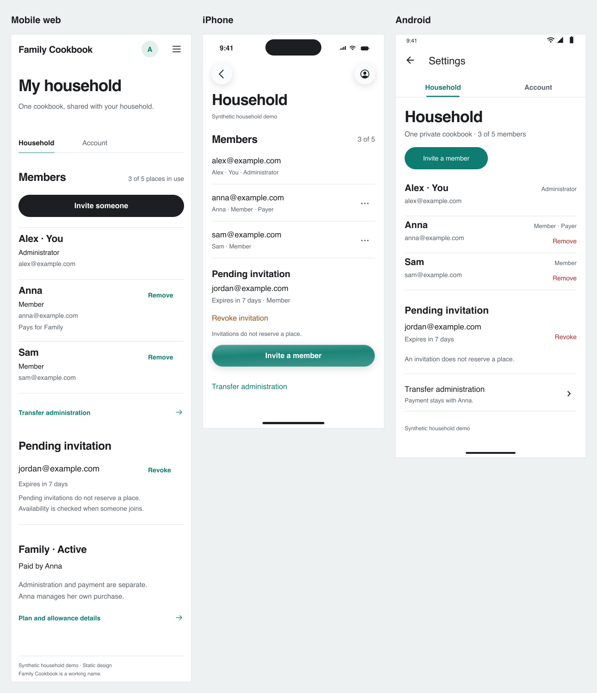
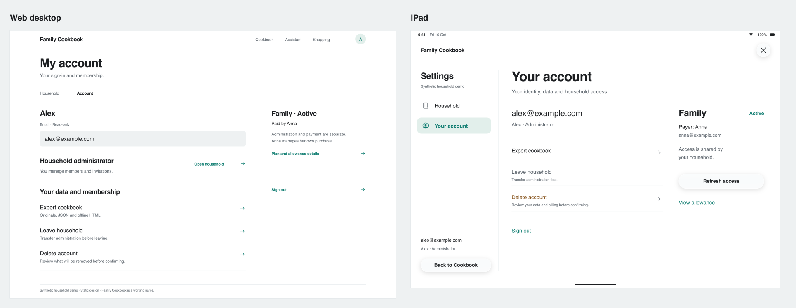
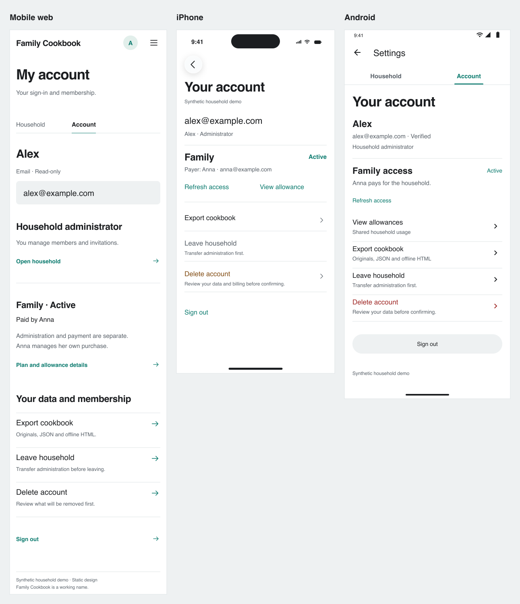

# Household and account

Twenty-four static proposals for desktop web, mobile web, iPhone, iPad and Android. Smakopas typography and simple composition continue with Liquid Glass projected onto Apple navigation and controls, and opaque Material controls on Android. Each screen has a PNG export at 2x and an editable SVG drawing. Awaiting user review; no application implementation.

## Household, members and invitations

Alex administers the household; Anna is its payer. Three members occupy three of five places. Jordan's pending invitation does not reserve a place. Member removal is separate from deleting an account or its contributions.

| Surface | PNG | SVG |
| --- | --- | --- |
| Desktop web | [Household](web-desktop-household.png) | [Source](web-desktop-household.svg) |
| Mobile web | [Household](web-mobile-household.png) | [Source](web-mobile-household.svg) |
| iPhone | [Household](iphone-household.png) | [Source](iphone-household.svg) |
| iPad | [Household](ipad-household.png) | [Source](ipad-household.svg) |
| Android | [Household](android-household.png) | [Source](android-household.svg) |

## Account settings

Account identity, verified access, allowances, export, leaving, deletion and signing out have distinct places. Native screens do not promote checkout. Leaving as administrator requires an accepted handover first; account deletion has its own review and does not depend on somebody else accepting that handover. These screens show entry points, not completed exports or destructive actions.

| Surface | PNG | SVG |
| --- | --- | --- |
| Desktop web | [Account](web-desktop-account.png) | [Source](web-desktop-account.svg) |
| Mobile web | [Account](web-mobile-account.png) | [Source](web-mobile-account.svg) |
| iPhone | [Account](iphone-account.png) | [Source](iphone-account.svg) |
| iPad | [Account](ipad-account.png) | [Source](ipad-account.svg) |
| Android | [Account](android-account.png) | [Source](android-account.svg) |

## Create and share an invitation

The [creation form](web-mobile-create.png) binds the invitation to an email address. The following state is a newly created invitation, not proof of delivery. No email has been sent: the administrator copies and shares its private link. The link is single-use and expires after seven days. Its secret value is not displayed in these synthetic drawings. Existing pending-list entries can be revoked, but cannot recover the original token for later copying.

| Surface | PNG | SVG |
| --- | --- | --- |
| Desktop web | [Invitation ready](web-desktop-invite.png) | [Source](web-desktop-invite.svg) |
| Mobile web | [Invitation ready](web-mobile-invite.png) | [Source](web-mobile-invite.svg) |
| iPhone | [Invitation ready](iphone-invite.png) | [Source](iphone-invite.svg) |
| iPad | [Invitation ready](ipad-invite.png) | [Source](ipad-invite.svg) |
| Android | [Invitation ready](android-invite.png) | [Source](android-invite.svg) |

## Review and join

Jordan is signed in with a verified email and has pasted an invitation link or code. Joining requires an explicit action; email matching, capacity and invitation validity are checked at acceptance. No member list, inviter identity or live occupancy is disclosed before membership. Native entry can use a pasted invitation link or code, without implying an approved universal-link domain.

| Surface | PNG | SVG |
| --- | --- | --- |
| Desktop web | [Join household](web-desktop-join.png) | [Source](web-desktop-join.svg) |
| Mobile web | [Join household](web-mobile-join.png) | [Source](web-mobile-join.svg) |
| iPhone | [Join household](iphone-join.png) | [Source](iphone-join.svg) |
| iPad | [Join household](ipad-join.png) | [Source](ipad-join.svg) |
| Android | [Join household](android-join.png) | [Source](android-join.svg) |

## Supporting states

| State | PNG | SVG |
| --- | --- | --- |
| Create an email-bound invitation | [Mobile web](web-mobile-create.png) | [Source](web-mobile-create.svg) |
| Invitation unavailable | [Mobile web](web-mobile-expired.png) | [Source](web-mobile-expired.svg) |
| Handover awaiting Sam's acceptance | [iPad](ipad-handover.png) | [Source](ipad-handover.svg) |
| Confirm Sam's removal | [Android](android-remove.png) | [Source](android-remove.svg) |

These are synthetic alternatives, not records of real accounts or a single completed session. Handover leaves Alex as administrator until Sam accepts; payment and recipe authorship remain separate. The unavailable-invitation screen offers recovery without claiming a precise server diagnosis.

## Design record

- [Behavior, remaining states and scope](design-brief.md)
- [Visual review and validation limits](visual-review.md)
- [Assets and provenance](credits.md)
- [Shared fictional scenario](source/scenario.json)
- [Artifact hashes](manifest.json)

These drawings do not establish native behavior, accessibility compliance or user approval. Detailed deletion/export review, role-specific payer management and unillustrated recovery states remain future design work. T03 and T09 retain their existing blockers; both readiness gates remain unchanged.
