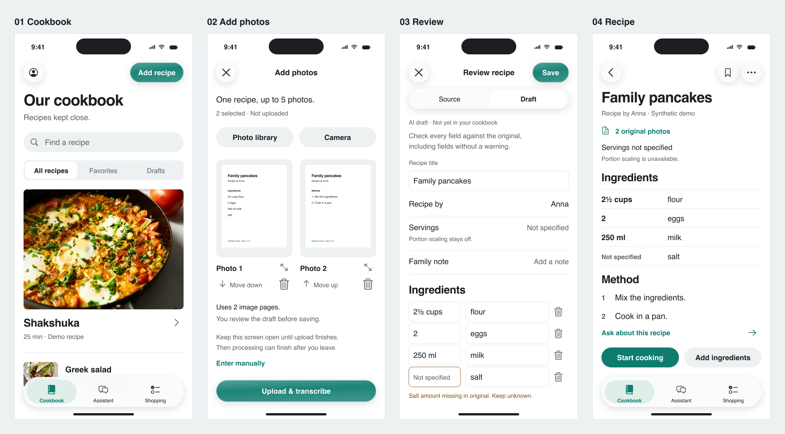
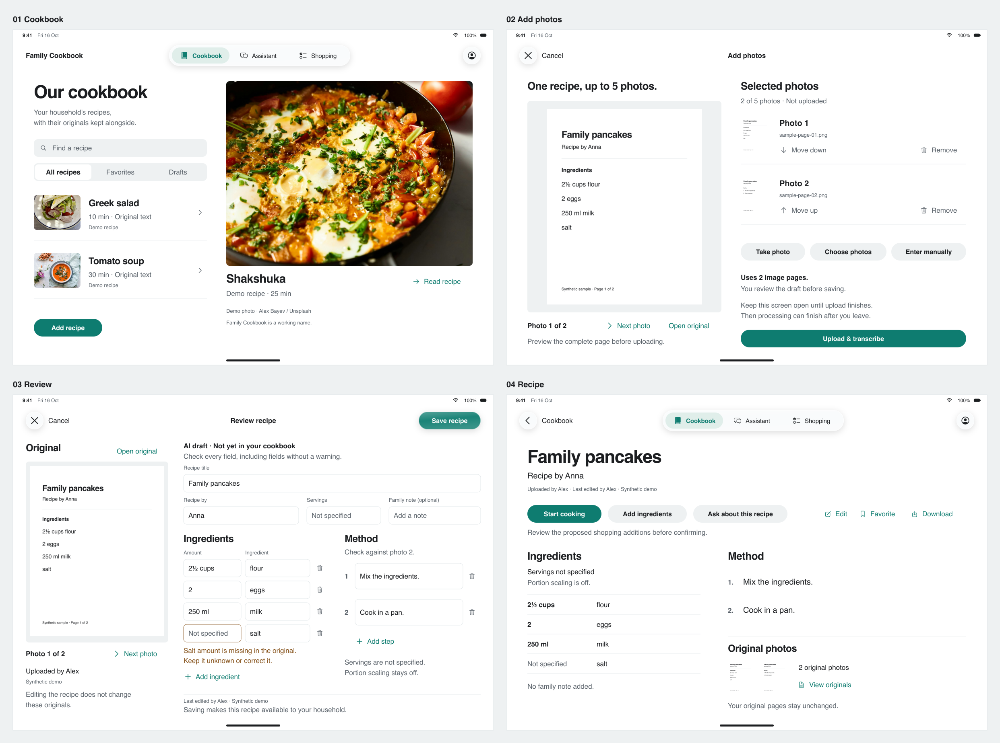

# Smakopas-based iPhone and iPad mockups

Static design proposal, 2026-10-16. Eight main screens continue the Smakopas web studies with Archivo typography, white reading surfaces and restrained teal accents. Apple navigation and controls use SF Pro Text, SF Symbols and a drawn Liquid Glass treatment. This packet contains no application implementation or interactive prototype.

## iPhone flow

## iPad flow

## Individual screens

PNGs preserve the exported appearance at 2x. SVGs retain text and drawing geometry; native labels require the locally installed SF Pro Text font when rendered again.

| Screen | iPhone, 393 x 852 | iPad landscape, 1194 x 834 |
| --- | --- | --- |
| Cookbook | [PNG](iphone-01-cookbook.png) · [SVG](iphone-01-cookbook.svg) | [PNG](ipad-01-cookbook.png) · [SVG](ipad-01-cookbook.svg) |
| Add photos | [PNG](iphone-02-add-photos.png) · [SVG](iphone-02-add-photos.svg) | [PNG](ipad-02-add-photos.png) · [SVG](ipad-02-add-photos.svg) |
| Review | [PNG](iphone-03-review.png) · [SVG](iphone-03-review.svg) | [PNG](ipad-03-review.png) · [SVG](ipad-03-review.svg) |
| Recipe | [PNG](iphone-04-recipe.png) · [SVG](iphone-04-recipe.svg) | [PNG](ipad-04-recipe.png) · [SVG](ipad-04-recipe.svg) |

Two supplemental iPhone views expose the same review's [Source tab](iphone-review-source.png) and [lower form](iphone-review-lower.png), with [Source SVG](iphone-review-source.svg) and [lower-form SVG](iphone-review-lower.svg). They preserve readable sizes instead of squeezing the entire review into one viewport.

## Design rationale and limits

The iPhone separates source and draft through a segmented control. The iPad presents the original beside the editable recipe. Native navigation sits above opaque content; recipe text, source pages and form fields are never glass surfaces.

The imported recipe is the same synthetic Family pancakes example used in web capture. It preserves `2½ cups`, unknown salt quantity and unknown servings. The final recipe has no invented dish photo, time or serving count. English artwork follows repository rules; Polish localization remains a separate validation step.

Liquid Glass is illustrated with static blur, edges and tint. These pixels do not reproduce adaptive system materials or establish native accessibility and interaction behavior. The [design brief](design-brief.md), [Apple references](apple-reference.md), [asset credits](credits.md), [visual review](visual-review.md) and [manifest](manifest.json) document the choices and evidence.

The [artboard exporter](source/render.cjs) and device drawing files create design artifacts only. The [symbol exporter](source/export-symbols.swift) extracts SF Symbols through AppKit; it does not build application screens. No implementation, simulator run or physical-device test is included. User review remains pending. T03, T09 and both readiness gates are unchanged.
