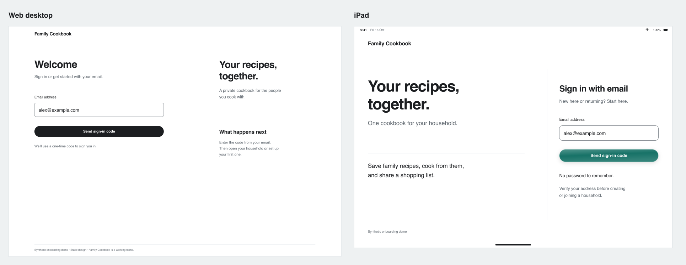
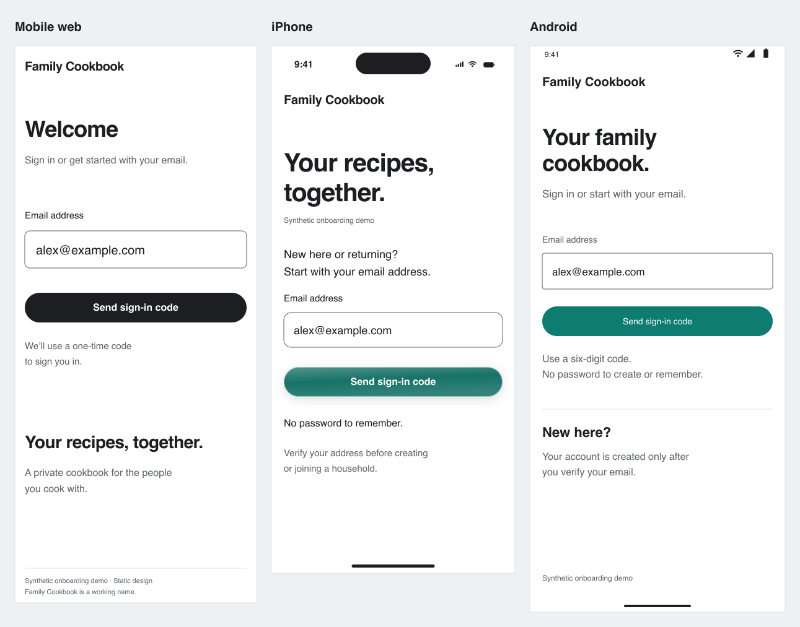
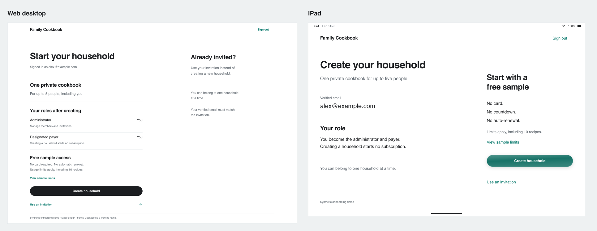
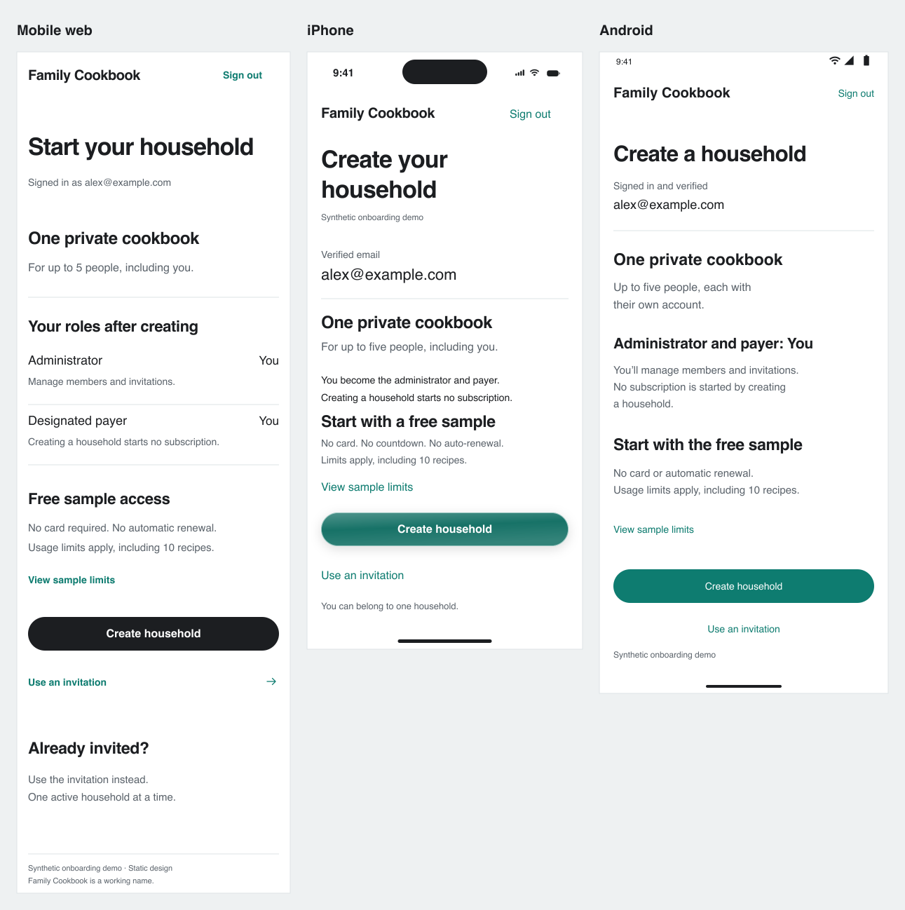

# Email sign-in and household creation

Twenty-five static proposals for desktop web, mobile web, iPhone, iPad and Android phone. The Smakopas typography and simple composition continue, with Liquid Glass illustrated on Apple controls and opaque Material treatments on Android. Each screen has a PNG export at 2x and an editable SVG drawing. Awaiting user review; no application implementation.

## Continue with email

New and returning people use the same flow. Entering an email requests a sign-in code; it does not prove delivery, create a household or reveal whether an account already exists. The fictional email is `alex@example.com`.

| Surface | PNG | SVG |
| --- | --- | --- |
| Desktop web | [Email](web-desktop-email.png) | [Source](web-desktop-email.svg) |
| Mobile web | [Email](web-mobile-email.png) | [Source](web-mobile-email.svg) |
| iPhone | [Email](iphone-email.png) | [Source](iphone-email.svg) |
| iPad | [Email](ipad-email.png) | [Source](ipad-email.svg) |
| Android | [Email](android-email.png) | [Source](android-email.svg) |

## Verify the code

One field accepts the six-digit code. The main artwork shows it empty, with verification unavailable until six digits are entered. Codes expire after five minutes; requesting another code replaces the previous one. The UI offers changing the email or requesting a new code without an invented resend countdown.

| Surface | PNG | SVG |
| --- | --- | --- |
| Desktop web | [Code](web-desktop-code.png) | [Source](web-desktop-code.svg) |
| Mobile web | [Code](web-mobile-code.png) | [Source](web-mobile-code.svg) |
| iPhone | [Code](iphone-code.png) | [Source](iphone-code.svg) |
| iPad | [Code](ipad-code.png) | [Source](ipad-code.svg) |
| Android | [Code](android-code.png) | [Source](android-code.svg) |

## Create one private household

After verification, Alex has no active household membership. Creating one is an explicit action. It assigns separate administrator and payer responsibilities to Alex and begins the card-free application sample; it makes no purchase or automatic renewal. The alternative `Use an invitation` opens the separate joining path. The limited sample includes ten saved recipes, with an entry to its full limits. `Sign out` allows changing the verified account. No household-name, avatar or payment form is invented.

| Surface | PNG | SVG |
| --- | --- | --- |
| Desktop web | [Create household](web-desktop-create.png) | [Source](web-desktop-create.svg) |
| Mobile web | [Create household](web-mobile-create.png) | [Source](web-mobile-create.svg) |
| iPhone | [Create household](iphone-create.png) | [Source](iphone-create.svg) |
| iPad | [Create household](ipad-create.png) | [Source](ipad-create.svg) |
| Android | [Create household](android-create.png) | [Source](android-create.svg) |

## Start the cookbook

The created-state fixture has one of five members and no saved recipes. It opens the first-recipe flow, member invitations or the empty cookbook without requiring either action. The sample is not a paid Family subscription, a timed provider trial or evidence that quota accounting is implemented.

| Surface | PNG | SVG |
| --- | --- | --- |
| Desktop web | [Ready](web-desktop-ready.png) | [Source](web-desktop-ready.svg) |
| Mobile web | [Ready](web-mobile-ready.png) | [Source](web-mobile-ready.svg) |
| iPhone | [Ready](iphone-ready.png) | [Source](iphone-ready.svg) |
| iPad | [Ready](ipad-ready.png) | [Source](ipad-ready.svg) |
| Android | [Ready](android-ready.png) | [Source](android-ready.svg) |

## Alternatives and recovery

| State | PNG | SVG |
| --- | --- | --- |
| Invalid or expired code | [Mobile web](web-mobile-code-error.png) | [Source](web-mobile-code-error.svg) |
| Invitation retained through sign-in | [Mobile web](web-mobile-invited.png) | [Source](web-mobile-invited.svg) |
| Code recovery | [iPhone](iphone-code-expired.png) | [Source](iphone-code-expired.svg) |
| Code-request outcome unconfirmed | [Android](android-request-error.png) | [Source](android-request-error.svg) |
| Existing household found | [Android](android-existing-household.png) | [Source](android-existing-household.svg) |

These are independent synthetic alternatives. Jordan's invitation remains private through authentication and is reviewed afterward; sign-in neither accepts it nor creates another household. The [household packet](../smakopas-household-v4/README.md#review-and-join) provides the subsequent explicit Join screen. Existing members return to their cookbook. A transport error does not establish whether an email was delivered.

## Design record

- [Behavior, remaining states and scope](design-brief.md)
- [Visual review and validation limits](visual-review.md)
- [Assets and provenance](credits.md)
- [Shared synthetic scenario](source/scenario.json)
- [Artifact hashes](manifest.json)

The artwork implements no authentication, email delivery, native autofill, account creation, membership operation or payment. T03 and T09 retain their existing blockers; neither readiness gate changes.
