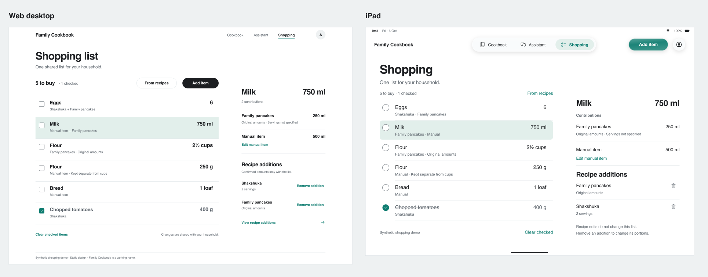
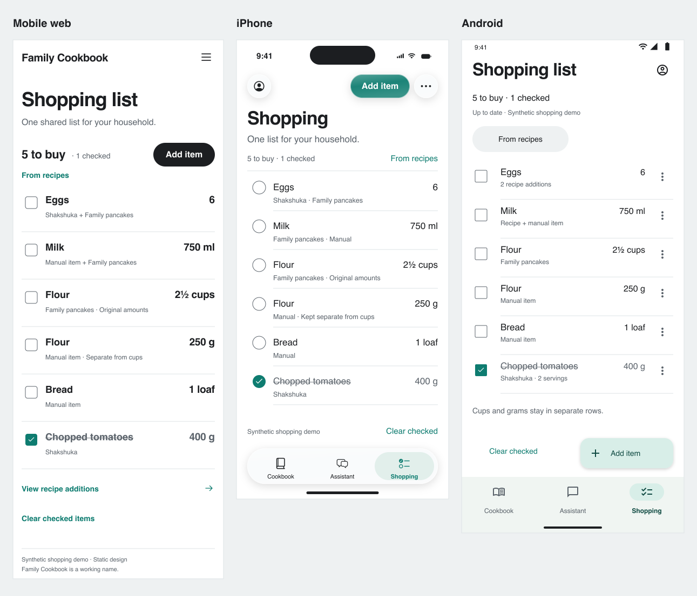

# Shared shopping list

Static Smakopas-style proposals for desktop web, mobile web, iPhone, iPad and Android phone. Fourteen screens, exported as PNG at 2x with SVG sources. Awaiting user review. No application implementation.

## Main list

| Surface | Full-resolution PNG | SVG |
| --- | --- | --- |
| Desktop web | [Shopping list](web-desktop-list.png) | [Source](web-desktop-list.svg) |
| Mobile web | [Shopping list](web-mobile-list.png) | [Source](web-mobile-list.svg) |
| iPhone | [Shopping list](iphone-list.png) | [Source](iphone-list.svg) |
| iPad landscape | [Shopping list](ipad-list.png) | [Source](ipad-list.svg) |
| Android phone | [Shopping list](android-list.png) | [Source](android-list.svg) |

The six-row list contains five items to buy and one checked item. Eggs and Milk combine compatible contributions; Flour in cups and grams remains separate. Desktop web and iPad expose the selected item's contributions beside the list. Compact layouts prioritize readable quantities and reachable checks.

## Confirm recipe additions

These screens occur **before** the main list. Three selected ingredients from Family pancakes add one row and update two existing rows. Salt remains unspecified and is explicitly excluded by the fictional user. Servings are unknown, so the original recipe quantities are used.

| Surface | Full-resolution PNG | SVG |
| --- | --- | --- |
| Desktop web | [Review additions](web-desktop-confirm.png) | [Source](web-desktop-confirm.svg) |
| Mobile web | [Review additions](web-mobile-confirm.png) | [Source](web-mobile-confirm.svg) |
| iPhone | [Review additions](iphone-confirm.png) | [Source](iphone-confirm.svg) |
| iPad landscape | [Review additions](ipad-confirm.png) | [Source](ipad-confirm.svg) |
| Android phone | [Review additions](android-confirm.png) | [Source](android-confirm.svg) |

`From recipes` enters recipe selection; a chosen recipe leads to this confirmation. The intermediate recipe picker is not separately drawn. Manual `Add item` remains a separate action.

## Alternative states

| Surface | Full-resolution PNG | SVG |
| --- | --- | --- |
| Mobile web | [Offline, two pending checks](web-mobile-offline.png) | [Source](web-mobile-offline.svg) |
| iPhone | [Offline, two pending checks](iphone-offline.png) | [Source](iphone-offline.svg) |
| Android phone | [Offline, two pending checks](android-offline.png) | [Source](android-offline.svg) |
| Desktop web | [Updated Milk, pending check rejected](web-desktop-updated.png) | [Source](web-desktop-updated.svg) |

Offline illustrations show Eggs and Bread checked locally, with two pending changes. Only checking and unchecking is available offline. The updated-Milk illustration is a separate alternative: the server's 500 ml remains and the stale local check is discarded. It is not a continuation of the depicted offline state.

## Design and evidence

- [Design brief and interaction boundaries](design-brief.md)
- [Visual review and limitations](visual-review.md)
- [Asset and scenario provenance](credits.md)
- [Shared synthetic scenario](source/scenario.json)
- [Artifact manifest and hashes](manifest.json)

Archivo and the simple Smakopas composition remain shared. Apple navigation and controls use a static Liquid Glass projection and SF Symbols; Android uses opaque Material surfaces, Roboto chrome and Material Symbols. The drawings do not demonstrate native runtime materials, accessibility semantics or synchronization.

No feature development, complete visual-system approval or readiness-gate pass follows from this packet. T03 physical-device testing and the existing T09 gaps remain open and unchanged.
