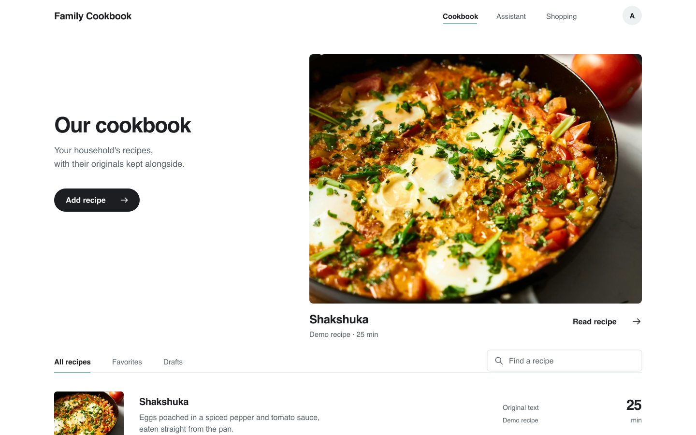
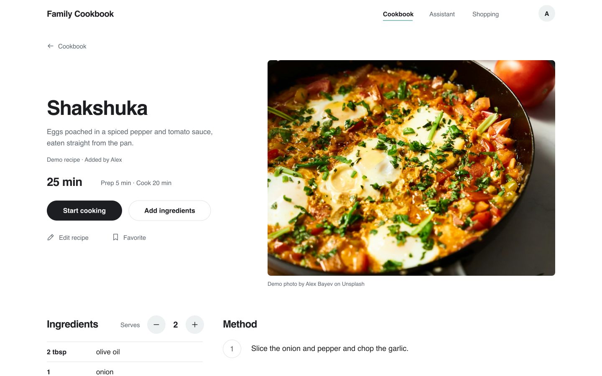
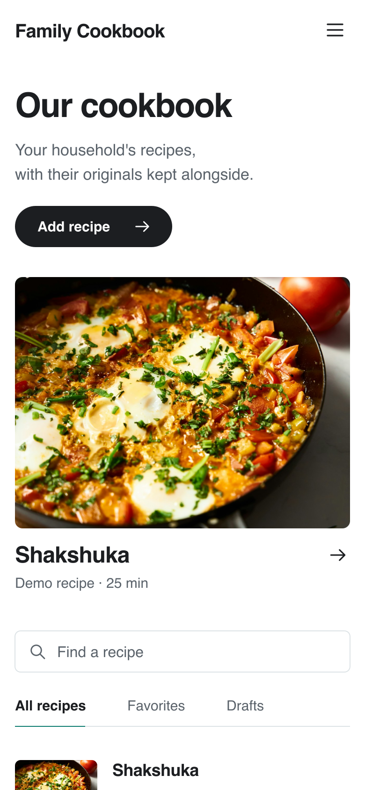
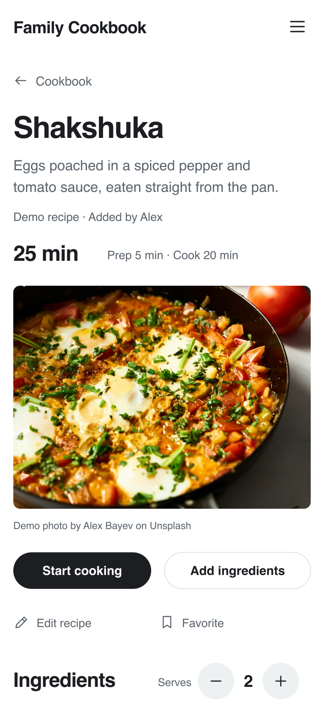

# Smakopas-based web mockups

Eight main static design studies, created 2026-10-15 and extended 2026-10-16. The developer requested continuation in the same Smakopas style. The new screens await review; there is no application implementation or approved complete design system.

The supplied Smakopas design is the primary reference: actual Archivo, white reading surfaces, restrained rules and deliberate columns. The [new capture gallery](capture-gallery.md) contains Add photos and Review. See the [reading brief](design-brief.md), [capture brief](capture-brief.md), [credits](credits.md) and [visual review](visual-review.md).

## Complete flow

| Screen | Full page | First viewport | Editable vector |
| --- | --- | --- | --- |
| Cookbook, desktop | [1440 x 1510 PNG](desktop-cookbook.png) | [1440 x 900 PNG](desktop-cookbook-fold.png) | [SVG](desktop-cookbook.svg) |
| Recipe, desktop | [1440 x 1640 PNG](desktop-recipe.png) | [1440 x 900 PNG](desktop-recipe-fold.png) | [SVG](desktop-recipe.svg) |
| Cookbook, mobile web | [390 x 1416 at 2x](mobile-cookbook.png) | [390 x 844 at 2x](mobile-cookbook-fold.png) | [SVG](mobile-cookbook.svg) |
| Recipe, mobile web | [390 x 2410 at 2x](mobile-recipe.png) | [390 x 844 at 2x](mobile-recipe-fold.png) | [SVG](mobile-recipe.svg) |
| Add photos, desktop | [1440 x 1070 PNG](desktop-add-photos.png) | [1440 x 900 PNG](desktop-add-photos-fold.png) | [SVG](desktop-add-photos.svg) |
| Review, desktop | [1440 x 1610 PNG](desktop-review.png) | [1440 x 900 PNG](desktop-review-fold.png) | [SVG](desktop-review.svg) |
| Add photos, mobile web | [390 x 1465 at 2x](mobile-add-photos.png) | [390 x 844 at 2x](mobile-add-photos-fold.png) | [SVG](mobile-add-photos.svg) |
| Review, mobile web | [390 x 1900 at 2x](mobile-review.png) | [390 x 844 at 2x](mobile-review-fold.png) | [SVG](mobile-review.svg) |

The supplemental [mobile Source tab](mobile-review-source.png) shows the other state of Review, with its [first viewport](mobile-review-source-fold.png) and [SVG](mobile-review-source.svg).

## Cookbook, desktop

The full page contains four entries, including a recipe without a dish photo or known duration. Source information remains visible for that entry.

## Recipe, desktop

The full page pairs ingredients and method, then provides access to the original. All ten ingredients and five steps match the mobile version.

## Cookbook, mobile web

## Recipe, mobile web

Mobile exports are browser compositions, not native iOS screens. The full-page files show content below the first viewport; they do not imply that the complete recipe fits on one phone screen.

## Artifact notes

SVG files contain real text, the embedded font and embedded photographs. The [exporter](source/render-artboards.cjs) produces static artwork only; there is no application route, HTML prototype or runtime behavior. The [manifest](manifest.json) records export dimensions and file hashes. Source notes are embedded in each raster file.

Family Cookbook remains a working name. English demo text follows repository artifact rules. Polish localization and functional validation remain separate work. T03, T09, both readiness gates and the implementation pause are unchanged.
