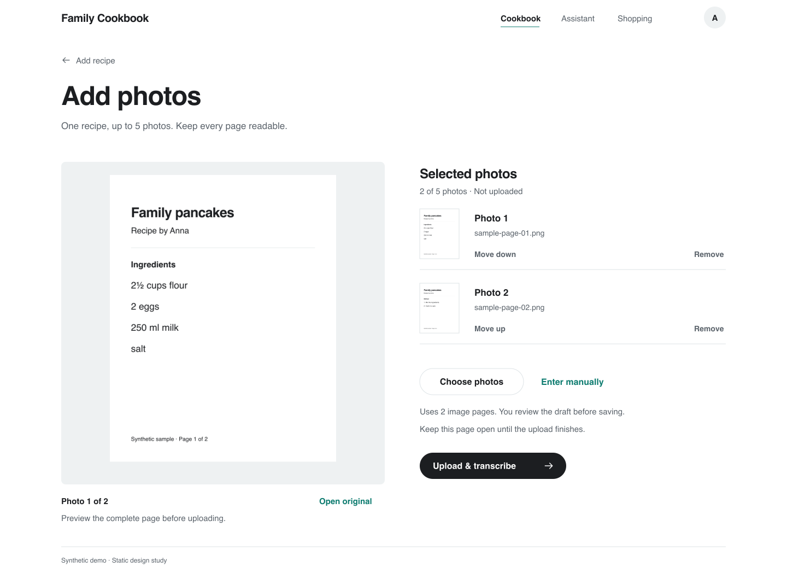
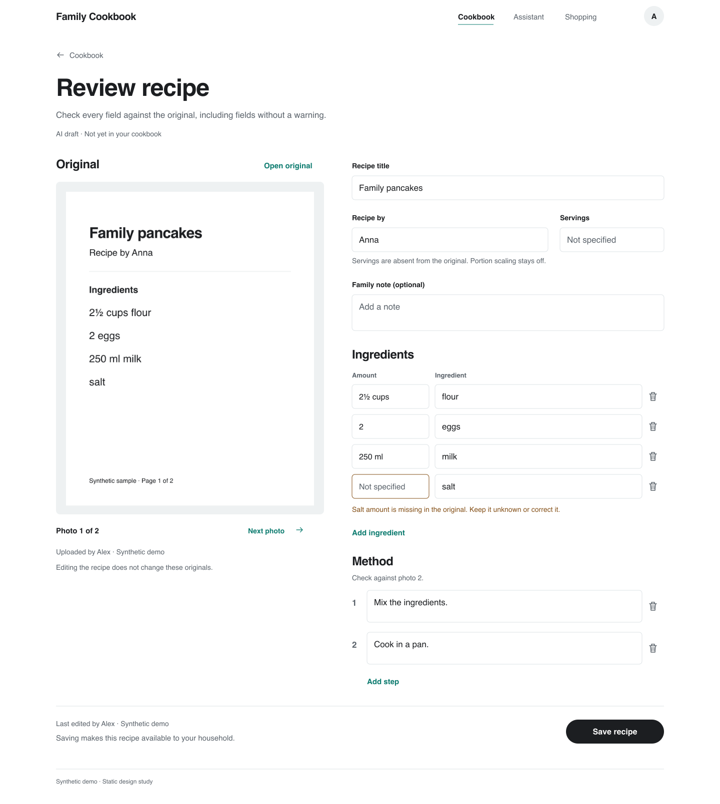
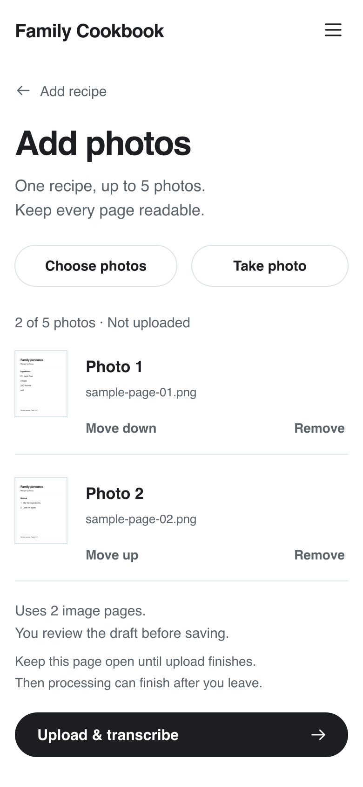
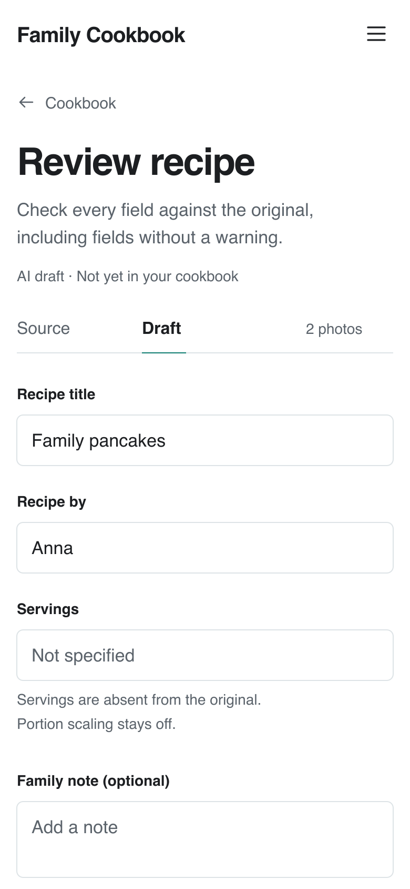
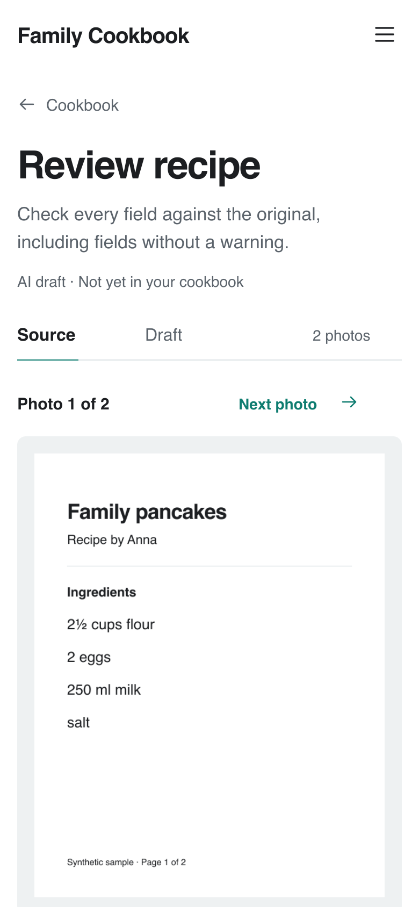

# Add photos and Review

Static web mockups, 2026-10-16. These extend [Cookbook and Recipe](README.md) with the same Archivo, white surfaces, proportions and restrained controls. No application implementation. All displayed source documents and people are synthetic examples.

| Screen | Desktop | Mobile web |
| --- | --- | --- |
| Add photos | [Full PNG](desktop-add-photos.png) · [SVG](desktop-add-photos.svg) | [Full PNG](mobile-add-photos.png) · [SVG](mobile-add-photos.svg) |
| Review | [Full PNG](desktop-review.png) · [SVG](desktop-review.svg) | [Full PNG](mobile-review.png) · [SVG](mobile-review.svg) |

## Add photos, desktop

Two selected images belong to one recipe. Their order, removal, source preview, quota cost and upload action are visible. The screen is explicitly before upload.

## Review, desktop

The original and editable draft sit side by side. Unknown servings and salt quantity remain explicit. Save recipe is a separate human decision at the end of the form.

## Add photos, mobile web

The [full mobile page](mobile-add-photos.png) continues with a complete source preview and manual-entry alternative. The upload instructions and action are already visible in this first viewport.

## Review, mobile web

The [full draft](mobile-review.png) continues through ingredients, steps and explicit Save recipe. The complementary source state uses the same header and switch:

[Full source view](mobile-review-source.png) · [Editable source-view SVG](mobile-review-source.svg)

The [capture brief](capture-brief.md) records intended interactions and missing states. PNGs demonstrate composition and content, not functional behavior or accessibility conformance. Neither T03 nor T09 is closed by this work.
