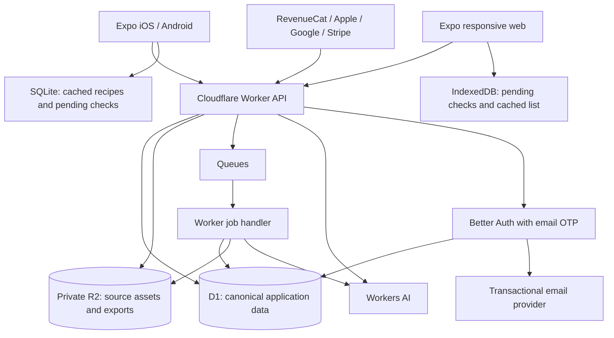

# Architecture and pilot readiness

Status: architecture, criteria and choices 1A/2A/3A accepted. Resolution: [Choose the architecture and release gates](issues/05-architecture-and-release-gates.md). This document records the implementation shape and evidence required before inviting pilot families. No implementation, model benchmark, purchase test or restore exercise has been performed.

## Smallest coherent system

One TypeScript workspace, one universal Expo application and one Cloudflare backend codebase. Use a modular monolith, with HTTP, queue-consumer and scheduled handlers sharing the same domain functions. Separate deployment environments, not separate business microservices.

### Components

| Component | Responsibility and boundary |
| --- | --- |
| Expo Router app | Shared navigation and product logic; platform-specific capture, storage and purchase adapters |
| Workers static assets | Serve the private app's web build; no SSR requirement |
| Worker API | Authentication integration, membership authorization, validated commands, queries and billing webhooks |
| D1 | Canonical household data, recipe revisions/provenance, jobs, operations, quotas, subscriptions and deletion workflow state |
| Private R2 | Original images/audio and short-lived exports; authorized reads, no permanent public URLs |
| Queues | Photo extraction, transcription/structuring and export work; messages contain references rather than full source content |
| Scheduled handler | Retry pending dispatch, reconcile billing, check stale jobs, process inactivity/deletion schedules |
| Workers AI | Candidate Whisper, Scout and Qwen models already researched; no unapproved external-model fallback |
| Better Auth + email | Email-code sign-in first, with native session storage and web cookies; Resend provides external email delivery |
| RevenueCat + purchase channels | Verify subscription state; household entitlement and roles remain application logic |
| Device speech | Read cooking steps; no cloud TTS or continuous voice conversation |

SQLite is the native persistence choice. Use IndexedDB for web pending checks instead of relying on Expo SQLite web's alpha support. Web cold-start offline is not promised; an already loaded app can continue checking its cached list. Persist changes before displaying them as saved. The full native/web persistence contract is tested, not inferred from React code reuse. [Expo SQLite](https://docs.expo.dev/versions/latest/sdk/sqlite/)

No Vectorize, Durable Objects, GraphQL, microservices, CRDTs, generic agent framework or ChatGPT integration in the initial implementation. Revisit a component only after a measured deficiency or failed invariant justifies it.

## Data and module boundaries

Use small domain modules for household/identity, recipes/capture, shopping/sync, assistant, billing/usage and deletion/export. Share only domain arithmetic, schemas and types used on both sides. Server authorization is never delegated to shared client code.

Every recipe, source, job and shopping record belongs to a household. Separate administrator membership from the payer's purchase identity. Native caches and pending operations are partitioned by account and household. An old session must not upload operations after removal, account deletion or switching household context.

Recipe attribution (for example a relative's name), the user who uploaded a source, and the user who edited a field are different concepts. Record source/contribution provenance from the first version. A single last-edited-by column is insufficient for the accepted deletion behavior. AI-derived drafts and approved fields must retain links to the source and contributing accounts relevant to removal.

Avoid retaining raw prompts, responses or voice data in general logs. Store only what the product needs, with explicit retention. The assistant receives a bounded set of authorized approved recipes and may not treat recipe text as instructions. Check returned recipe IDs against the retrieved set. Ingredient calculations and mutation permission checks remain deterministic code.

## Consistency rules

### Shopping

The accepted protocol uses stable operation IDs, explicit purchased states and item revisions. Persist the applied mutation and its operation outcome atomically, check duplicate operation IDs before treating a retry as stale, and process different items independently. Keep server-accepted changes on conflicts; never resurrect deleted items.

D1 supports transactional batches of predefined statements, but a conditional UPDATE changing zero rows is not a transaction error. The implementation must explicitly distinguish applied, stale, deleted and duplicate outcomes and couple the stored operation result to the actual outcome. Do not assume an interactive transaction can span independent Worker calls. Prove these invariants against the real D1-compatible execution environment before expanding the UI. [D1 database API](https://developers.cloudflare.com/d1/worker-api/d1-database/)

### Imports and allowances

Create the job and reserve its allowance together. Treat queue publication as a separate operation that may fail; a scheduled reconciliation finds pending dispatches. Consumers check persistent job identity and current authorization/deletion state before processing and before committing results. Completed jobs settle the reservation once; terminal failures release it. Queues delivery is at least once, so retry behavior is part of the design. [Queues delivery](https://developers.cloudflare.com/queues/reference/delivery-guarantees/)

Bound job attempts and send exhausted failures to an observable recovery path. Users can retry or type manually without losing an uploaded source. Exports are explicit jobs with temporary download availability, not public permanent buckets.

### Billing

Authenticate and deduplicate provider notifications, then reconcile verified provider status before updating household access. Refresh after purchase and restore, and periodically repair missed notifications. Role transfer does not move receipts. Block duplicate active household purchases and re-check at checkout. Model sample, active, grace, Archive and pending payer replacement explicitly; sample is not a provider subscription trial.

Usage windows follow the accepted equal-capacity plan, with the accepted original activation-day anchor and short-month clamping. Preserve the anchor and consumed counts across billing-period changes and payer replacement. This date calculation needs unit tests before the quota copy is finalized.

## Deletion and recovery are mandatory pilot capabilities

An accepted account-deletion request immediately prevents ordinary access and new writes. Purge active copies, sources, affected versions, conversations, exports and processor data within the agreed target. Cancellation of a job is not sufficient: a late result must be unable to recreate the deleted record. Keep a minimized deletion journal outside the restore scope of the application database so recovery can replay removals before reopening access.

Validate contribution-aware deletion with jointly edited recipes. An independently created recipe must not disappear merely because its editor left, but that editor's associated content must not survive hidden in history or source-derived answers. If correct removal cannot be demonstrated, the real-data pilot is blocked. This is the most consequential data-model proof required before building the full feature set.

D1 Time Travel restores the database, not deleted R2 source files. Maintain a private recovery copy of source assets in a separate bucket, with an explicit inventory, access controls and retention/deletion job. An upload is fully archived only when its required recovery copy exists. Account/source deletion purges both active and recovery objects. Do not keep indefinite object snapshots or public caches. Downloads users already exported are outside remote recall.

Recover a test household in isolation, replay the deletion journal, reconcile billing, disable outgoing email/AI jobs and verify content before permitting normal access. Application rollback must not replay deleted users, export links, queued imports or old payment decisions.

### Accepted retention amendment

Immediately revoke product access; purge active-system and processor copies within seven days; expire backup copies within thirty days after active deletion and no more than thirty-seven days from the request. The user explicitly accepted this amendment; it supersedes the earlier thirty-day-from-request target.

D1 Paid retains Time Travel history for thirty days and Time Travel is always on. A row removed on day seven can remain recoverable until approximately day thirty-seven. [D1 Time Travel](https://developers.cloudflare.com/d1/reference/time-travel/)

Inventory the maximum retention across all copies and processors. Replaying a deletion journal prevents exposure after recovery; it is not proof that an underlying backup is already irrecoverable. Validate the chosen retention commitments before inviting real-data participants.

## Environments and observability

Use separate development/test and pilot environments with separate databases, buckets, queues, auth origins, email restrictions and payment configurations. Never copy real family materials into automated tests without explicit consent and appropriate isolation.

Track job completion/failure, correction time, answer latency, conflict counts, quota consumption, billing reconciliation lag and deletion deadlines using pseudonymous operation IDs. Do not send recipes, recordings or full conversations into analytics. Provide an in-app support route and an assigned human pilot contact. Alert on failed deletion jobs, growing queue failures and payment inconsistencies.

CI runs type checks, domain unit tests and backend integration tests; Playwright covers web journeys. Use native development/test builds for permissions, recording, local persistence and IAP. Pin compatible dependencies at implementation time; this plan is not evidence that a specific dependency combination has run successfully.

## Gate 1: ready for invited real-data use

All blocking checks below must have recorded results, not just test names. Accepted numeric targets are internal acceptance criteria, not measured performance or industry standards.

| Area | Required evidence |
| --- | --- |
| Complete journey | Capture -> review -> save -> ask -> add to list -> shop -> cook works on web, iOS and Android; no open defect causing data loss or blocking a core flow |
| Isolation | Cross-household attempts fail for recipes, objects, export jobs, assistant references and sync; revoked membership/session/invitation tests pass |
| Capture quality | Fifty consented examples: thirty photographed recipes and twenty recordings, with reference transcriptions; at least forty can become usable through review in two minutes or less; all quantities/units/temperatures in saved evaluation outputs are checked against references |
| Grounded assistance | Thirty fixed questions including ten unanswerable cases; no fabricated recipe references, no private-data crossover, explicit missing-information responses, and no unconfirmed writes |
| Offline shopping | Airplane-mode edits survive restart; duplicate/lost acknowledgments, quantity changes, deletions, independent items and rapid local taps converge under the accepted policy on two devices |
| Deletion | Contributor-aware cleanup, late-job suppression and processor deletion verified; purge deadlines and backup-retention policy reconciled before real uploads |
| Recovery/export | Isolated restore includes sources and preserves deletion decisions; ZIP works without network and contains actual originals; native downloaded recipes reopen offline |
| Accessibility | Core web flows meet the WCAG 2.2 AA target through keyboard/contrast/label checks; VoiceOver and TalkBack cover capture, review and shopping with large text; no accessibility blocker in the core journeys |
| Performance | On documented pilot devices/network, p95 ordinary API latency below one second and text-answer completion below fifteen seconds over at least thirty runs each; five-minute audio jobs reach success or an actionable error within three minutes over ten representative runs |
| Operations | Support contact, alert routing, restore procedure, private-data logging controls and a workable incident pause path have been exercised |

Quality thresholds should be assessed per input class as well as overall so easy text does not hide unusable handwriting or speech. Record model failures, manual-entry fallback and correction effort separately. Passing this sample does not guarantee universal OCR accuracy.

## Gate 2: ready to accept real payment

In addition to Gate 1, record sandbox purchase/restore and account identity results for Apple and Google; verify web purchase grants the correct household access; test cancellation, expiry, provider grace, refunds, duplicate/delayed events and payer replacement. Record all accepted limits and their boundary behavior, including the one-time welcome allowance. Verify subscription management and deletion paths in each client.

Resolve the specific basis, scope and retention schedule for necessary billing records after account deletion for the operating entity and market. The product decision does not establish this factual/legal prerequisite. Configure actual local prices, renewal disclosures, email sender and deletion/retention notices before checkout goes live.

TestFlight purchases are sandbox, so they do not demonstrate willingness to pay. Google test tracks also require correct license-tester configuration; do not assume every test install makes free purchases. Source details are in [architecture evidence](architecture-evidence.md).

## Accepted pilot

Ten Polish-speaking households for six weeks, with real family recipes and both iOS and Android represented. At least three households should use both native and web during the pilot. This is a bounded operational choice, not a claim that Poland is the largest opportunity.

Weeks 1-2: invitation-only use of the accepted card-free sample; native purchases remain test-only. Gate 1 must already be satisfied. Do not auto-start a timed trial or override the approved sample offer merely because the pilot lasts six weeks.

Weeks 3-6: after Gate 2, offer the accepted real paid plan through the website; native clients recognize the same household entitlement. Keep test and live purchase environments isolated: sandbox purchase tests use synthetic fixture households, while real pilot access comes only from verified live purchases. Do not let a sandbox receipt grant a production paid household entitlement. Native pilot clients can read the live household state without presenting a live native purchase flow. Do not put an external checkout promotion into native builds as a shortcut around store requirements. Participants can decline purchase and keep sample/Archive access under the accepted policy.

Accepted learning goals: at least eight households complete a first reviewed recipe; at least five use recipes or shopping in three of the final four weeks; at least three deliberately buy the stated offer. These are go/no-go hypotheses for the product, not pre-entry gates and not evidence of annual retention. Public store release is a later decision requiring its own review and production configuration.

## Resolution

Architecture and gates accepted, with ten Polish-speaking households over six weeks, a real web-purchase phase after Gate 2, and the thirty-seven-day maximum backup-retention amendment. Planning acceptance is not a claim that any implementation test has passed. The final consolidated handoff is [MVP specification](spec.md).
