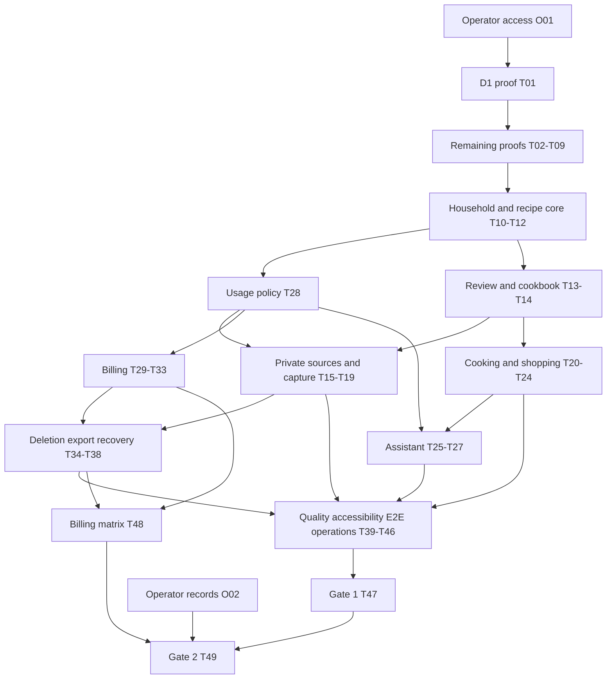

# Family cookbook MVP implementation plan

Baseline: 2026-10-15. Status: planned; no implementation task or readiness gate has passed.

This plan implements the approved [MVP specification](../spec.md). It does not reopen the five resolved Wayfinder decisions. The [task register](todo.md) contains 51 items: 47 engineering/verification tasks, two operator prerequisites and two readiness milestones. Each card specifies its outcome, direct dependencies, proposed files, three acceptance criteria and concrete checks. The [coverage matrix](coverage.md) maps requirements and both gates to those cards.

## 1. Scope and execution boundary

Build one private family cookbook for up to five members on Expo web, iOS and Android, with a modular Cloudflare Worker backend. Deliver reviewed photo/audio/manual capture, cooking, a grounded text assistant, shared shopping with offline check/uncheck, continuity, quotas and subscription access.

Keep the accepted EUR 4.99 monthly/EUR 39 annual reference offers, all sample/paid allowances and Archive rights unchanged. Exact compatible package versions, model IDs, codecs and resource identifiers are implementation findings. The Polish pilot remains ten households over six weeks. Do not add ChatGPT integration, full pantry tracking, calendar planning, public sharing or offline editing.

This artifact is an execution plan, not authorization to create provider accounts, charge customers, deploy production or submit public store builds. Application repository location and test access are explicit prerequisites in O01. This planning directory contains no application implementation or runnable application test suite. All cards start **not started**.

## 2. Start with the architectural proofs

Complete O01's relevant access inventory, then run the proofs below using synthetic or explicitly consented isolated evaluation data. O02 can progress independently. A proof must produce an executable check or reproducible device/provider record, not just a design explanation.

| Task | Risk | Minimum pass evidence | What depends on it |
| --- | --- | --- | --- |
| [T01: Prove atomic shopping mutations in D1](tasks/t01-prove-atomic-shopping-mutations-in-d1.md) | Atomic D1 mutation and outcome | Duplicate delivery, a lost response, two writers and a zero-row UPDATE cannot split the mutation from its durable outcome. | All command, quota and revision work |
| [T02: Prove contribution-aware recipe deletion](tasks/t02-prove-contribution-aware-recipe-deletion.md) | Contribution-aware erasure | Remove B-derived text/history/source while retaining A-independent content; incomplete survivors require review. | Recipe schema, exports and deletion |
| [T03: Prove native pending-check persistence](tasks/t03-prove-native-pending-check-persistence.md) | Native durable pending intent | Airplane mode and process termination preserve pending intent; old acknowledgments cannot erase newer taps. | Native offline shopping and downloads |
| [T04: Prove web pending-check persistence](tasks/t04-prove-web-pending-check-persistence.md) | Web durable pending intent | IndexedDB contract survives supported reloads/storage errors; account changes never replay another identity. | Loaded-web offline shopping |
| [T05: Prove queued-job allowance settlement](tasks/t05-prove-queued-job-allowance-settlement.md) | Queue and allowance boundary | Failed publication is redispatched; duplicate consumers settle once; deletion blocks late results. | All imports, usage and exports |
| [T06: Prove restore without deleted-data resurrection](tasks/t06-prove-restore-without-deleted-data-resurrection.md) | Recovery after deletion | Historical D1 plus R2 restore replays independent deletion records before access and jobs resume. | Private source storage and operational recovery |
| [T07: Prove authenticated sessions across platforms](tasks/t07-prove-authenticated-sessions-across-platforms.md) | Sessions on all platforms | Email OTP, native secure persistence and web cookies honor logout/revocation in real builds. | Households and protected UI |
| [T08: Prove purchase identity cannot cross households](tasks/t08-prove-purchase-identity-cannot-cross-households.md) | Purchase identity binding | A restored purchase cannot move to a different payer/household or cross sandbox/live boundaries. | Entitlement and purchase implementation |
| [T09: Verify capture models on representative fixtures](tasks/t09-verify-capture-models-on-representative-fixtures.md) | Real capture feasibility | Ten representative inputs expose handwriting, Polish speech, codec, schema, latency and cost failures. | Photo/audio pipeline and bounded model usage |

The first dependency chain is **O01 -> T01 -> T02/T03/T05**. T04 follows T03; T06 follows T02 and T05; T07 follows T03; T08 follows T07; T09 follows T05. T10 explicitly depends on completion of all nine proofs, directly or transitively, so broad feature work cannot silently bypass an unresolved architecture risk.

Checkpoints: after T01-T03, review transactional/provenance/local-state contracts; after T04-T06, review cross-platform persistence and recovery; after T07-T09, review identity, provider and model feasibility. These are evidence reviews, not new product-approval rounds. If access is missing, continue ready independent proofs. If a proof fails, stop its dependent tasks, record the failing case and revise the smallest technical design. A change to accepted product behavior requires a decision rather than a hidden relaxation.

The ten-input capture smoke test is only a feasibility screen. It does not satisfy the later 50-example quality gate. Similarly, a mocked purchase or local D1 test does not prove real provider identity or remote D1 semantics.

## 3. Deliver in vertical slices

Task numbers are stable identifiers, not an instruction to execute every number sequentially. Follow dependencies. In particular, implement T28's shared usage policy immediately after the minimal recipe core; capture and assistant tasks require it.

| Stage | Tasks and intended outcome | Review boundary |
| --- | --- | --- |
| Operator preparation | O01 resources/repository; O02 entity, retention and commercial facts | Record missing access/facts and their deadlines |
| Architecture | T01-T09 | Three proof checkpoints above |
| Private book | T10-T12 household, succession and recipe persistence; T28 common limits; T13-T14 review and browsing | First human-reviewed recipe, valid membership and quota enforcement |
| Sources and capture | T15-T17 private recoverable images to reviewed recipe; T18-T19 audio through the same pipeline | Review image slice, then audio slice |
| Everyday cooking | T20-T21 readable cooking and native downloads | Restart without a network |
| Shared shopping | T22-T24 deterministic contributions and durable offline checks | Two members, concurrent edits and reconnect |
| Cookbook assistant | T25-T27 bounded retrieval, private conversation and confirmed meal-to-shopping | Missing facts and explicit write confirmation |
| Subscription lifecycle | T29-T31 reconciliation and purchase channels; T32-T33 Archive and payer succession | Review provider state, then expiry/transition |
| Account continuity | T34-T36 deletion and inactivity; T37-T38 export and recovery | Review purge, then offline export/restoration |
| Operational readiness | T39 alerts/runbooks; T40-T43 accessibility and integrated journeys; T44-T46 quality/latency | Review after each pair/triple of evaluation cards |
| Release evidence | T47 Gate 1; T48 billing matrix; T49 Gate 2 | Each gate is a separate go/no-go |

The first usable product slice is sign-in -> household -> manual review/save -> private image upload -> asynchronous draft -> approval -> source access. Dictation reuses that draft pipeline. Export needs the deletion invariants, so its full acceptance follows continuity work; do not onboard real families before it passes.

Billing identity is proven early, and the shared usage core is built early. Full billing UI and provider-state work may proceed independently of capture after T28. This avoids discovering an incompatible payer model after completing the product.



This graph summarizes workstreams; individual cards are authoritative for exact dependencies. Logical blockers include T02 before recipe persistence, T06 before private recovery storage, and T08 before purchase implementation. A calendar critical path cannot be estimated honestly until proof results, team availability and provider access are known.

## 4. Repository and implementation boundaries

Use one TypeScript workspace with the following proposed structure:

```text
apps/app/             Expo Router screens and platform adapters
apps/api/             Worker HTTP, queue and scheduled handlers; D1 migrations
packages/domain/      Pure quantities, calendar, state and access rules
packages/schemas/     Shared validated request/result shapes when both sides need them
tests/web/            Playwright browser journeys
tests/native/         Reproducible device checklists and supporting fixtures
tests/recovery/       Isolated restore/deletion scenarios
tests/fixtures/       Synthetic or consented reference manifests
scripts/evaluation/   Repeatable quality and latency measurements
docs/evidence/        Task results with build/environment identifiers
docs/runbooks/        Recovery, deletion and incident procedures
```

Paths on task cards are proposed primary change locations, not an existing codebase or a fixed file-count promise. First owning tasks add only necessary workspace/configuration files: T01 establishes Worker/D1 tests and root scripts; T03 establishes the Expo development shell and native tests; T04 establishes Playwright; T07 establishes auth configuration. Pin compatible versions then, using current official documentation. Shared schemas appear when there is an actual API consumer; avoid a speculative generic framework.

One owner coordinates migrations and shared contracts. Independent contributors can work on ready tasks with separate modules, but migrations, auth/household boundaries, quota contracts and shared routes must be integrated serially and checked together. This plan does not dispatch parallel agents. Reuse successful proof code; remove temporary proof routes when their production slice replaces them.

## 5. Verification and task completion

Every card starts with a specific failing behavior or evidence gap. Use unit tests for pure arithmetic/state/calendar rules, Worker integration tests for D1/Queue/auth/lifecycle boundaries, Playwright for browser flows and real native development builds for device persistence, permissions, recording and purchases. Expo Go and browser emulation are insufficient evidence for native gates.

The proposed commands `pnpm test:api`, `pnpm test:app` and `pnpm test:web` do not exist in this planning workspace. Their first owning task must define them, including focused-file forwarding. Establish type checking, affected builds and an aggregate CI workflow as part of those harnesses. CI runs deterministic suites and protects results; remote destructive recovery exercises use explicitly isolated resources and device checks remain separately recorded. A command on a card is a future verification contract, not a claim that it ran.

A task is complete only when:

1. All direct dependencies pass and its acceptance criteria are demonstrated.
2. The focused regression/integration checks pass; the affected type check/build passes.
3. Required real-provider/device checks have evidence instead of a mocked substitute.
4. The diff contains only the slice, temporary scaffolding is removed when superseded, and interfaces preserve the specification.
5. A report records commit/build, environment, fixture set, commands, result, limitations and any blocking defect. Then update the card and register together.

Use a review checkpoint after at most three completed engineering tasks in a workstream, even when other streams are still running. Recheck dependency contracts, scope, tests and unresolved risk before expanding. Failed checks remain visible. Repeat broader checks when a shared contract changes; do not rerun unrelated evaluation sets without a reason.

Each card targets one focused slice, usually two to four primary files. Operator/evidence cards are smaller. Proofs, provider work and device matrices have uncertain elapsed time. If a card cannot fit one focused session, split it into smaller behavior-based children before continuing, retaining the same parent acceptance criteria and dependency gate. Do not interpret 51 cards as 51 fixed days.

## 6. Readiness gates and pilot handoff

**Gate 1 (T47)** requires passing capture/assistant evaluations, all three platforms, isolation, native offline recovery, deletion/retention, export, restore, accessibility, performance and operational evidence. No open data-loss, household-leak or core-flow blocker is allowed. The register and coverage matrix must link actual reports, not merely completed implementation checkboxes.

**Gate 2 (T49)** additionally requires the cross-channel billing matrix, correct sample/paid/Archive behavior and O02's real operator facts. Establish sandbox purchase evidence and separately verify the intended live web entitlement configuration and household mapping without creating a charge. Clearly label fixtures versus provider observations. Do not claim a live transaction was executed during planning or sandbox QA. The Gate 2 reviewer must explicitly resolve the evidence gap between a configured live route and proven live settlement; fixtures alone cannot be recorded as proof of a live purchase. If the accepted requirement cannot be verified without an early charge, record a narrow validation decision before claiming the gate has passed. After Gate 2, the first explicitly initiated real web purchase is monitored for correct entitlement; a failed grant pauses additional charges and follows the billing incident runbook.

O02 separates facts needed before real-data participation (operator identity, accurate notices, sender/support ownership) from commercial/retained-record prerequisites before charging. T47 checks the former; T49 checks the full record. Missing operator facts keep the applicable gate closed, even if engineering checks pass.

After Gate 1, the operator may arrange the accepted ten-household, six-week closed pilot through a separately authorized rollout. Weeks 1-2 use the quota-based sample, not a newly invented timed trial. Weeks 3-6 may offer real web purchases only after Gate 2; native sandbox QA stays separate. Record first reviewed recipe, repeat recipe/shopping use and verified deliberate purchases with content-free metrics. The accepted learning targets remain 8 first recipes, 5 households active in 3 of the final 4 weeks, and 3 purchasers. Pilot execution, production deployment and public-store submission are not tasks silently performed by this planning request.

## 7. Remaining implementation findings

No new product preference is needed to use this plan. O01 must establish the application repository and available test resources. T01-T09 must establish platform feasibility. O02 must establish operator-specific facts. Exact codec bounds, model identifiers, package versions and provider retention settings are measured findings, not invented commitments.

Prefer the accepted simple architecture until a proof shows it cannot meet a required invariant. Do not add Durable Objects, CRDTs, Vectorize, external-model fallbacks or a different payment model merely to avoid completing the proof. A proposed architecture change must include the failing case, smallest alternative, impact on scope/cost and updated acceptance evidence.
