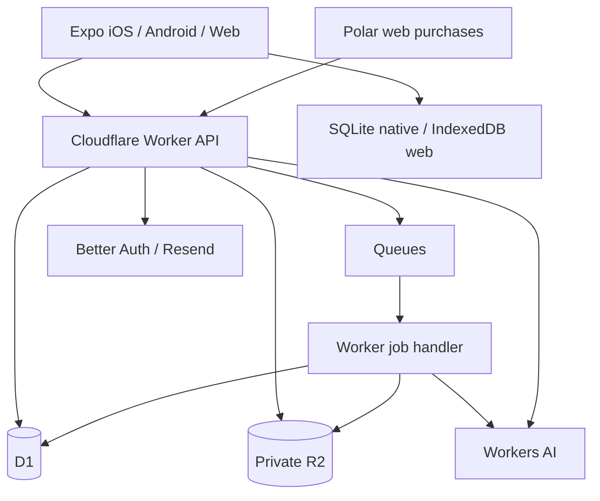

# Family cookbook MVP implementation specification

Version: 1.0 | Decision baseline: 2026-10-15 | Status: approved planning baseline, ready for implementation handoff.

All five decision tickets in the [Wayfinder map](map.md) are resolved. This document consolidates the final product and architecture contract. The ticket resolutions retain decision history; earlier alternatives are not requirements. At the original planning baseline, no application code, deployment, model benchmark, payment test or pilot readiness gate had been completed. Subsequent implementation and proof results are recorded in the [task register](implementation/todo.md) and linked evidence.

**Current phase: UX/UI design preparation; feature implementation is paused by developer direction. Real family-data participation requires Gate 1. Real charges require Gate 2. Neither gate has passed.**

## 1. Product and scope

Preserve a family's recipes from photographs, spoken explanations or text, then make the reviewed recipes useful for cooking and shared shopping.

- One private cookbook per household, up to five people including the payer, each with their own account.
- One active household membership per user is the MVP boundary; no multiple-book switcher or overlapping family organizations.
- One administrator and one payer; initially the creating user holds both responsibilities, but they may be different people later.
- Responsive web, iOS and Android. Start with ten Polish-speaking pilot households; preserve original measurements and provide metric display where conversion is valid.
- The assistant answers from approved recipes and may give explicitly requested, clearly labeled general cooking advice. It never silently rewrites a family original.
- The initial customer is the person organizing family recipes and using them in everyday cooking. Payment and repeat usage must be tested, not assumed.

Account deletion, subscription expiry, administrator handover and payer replacement are distinct operations. Administrative authority is not authorship of all household content. Domain vocabulary is recorded in [CONTEXT.md](CONTEXT.md).

## 2. Screens and navigation

Main tabs: Cookbook, Assistant, Shopping. Add Recipe is a prominent action in Cookbook; profile opens household/account settings. Source preview, purchase, invitations and shopping confirmation are subflows rather than additional tabs.

| Screen | Required behavior | Required edge states |
| --- | --- | --- |
| Welcome/sign-in | Email-code authentication; create household or accept invitation | Expired code/invitation, rate limit, existing membership, delivery failure |
| Cookbook | Recipe cards with attribution, title/ingredient/tag search, favorites, drafts awaiting review, Add Recipe | Empty collection, load failure, stale/offline cache |
| Add Recipe | Camera/gallery images, recorded recipe, pasted or manual text | Denied permissions, invalid media, interrupted upload, quota/storage limit |
| Import progress | Persistent job status, leave/return after upload, retry or manual-entry fallback | Failed/expired processing without loss of uploaded source |
| Review | Original and editable title, attribution, note, servings, ingredients and steps; explicit Save recipe | Unknown values, unreadable source, concurrent edit conflict |
| Recipe/cooking | Sources, portions, large steps, optional device speech, Ask about recipe, Add to shopping, edit/download | Unknown servings, unavailable offline source, stale version |
| Assistant | Typed questions scoped to the book or selected recipe; source cards; ingredient-to-meal suggestions | Empty book, no match, missing fact, quota limit, model/network failure |
| Shopping | One shared active list; recipe and manual items; quantities, origins, check/uncheck | Incompatible units, unknown quantities, pending offline changes, stale item |
| Household/account | Members, administrator transfer, payer status, allowances, manage/restore subscription, export, leave/delete account | Missing administrator, pending handover, payer transition, deletion/export failure |

Desktop review shows source and fields side by side; mobile switches between them. Core functions remain operable without voice. No microphone in Assistant in MVP; recipe dictation is a separate capture feature.

## 3. Capture, review and cooking

### Photos

One import creates one recipe draft from up to five ordered images. Preview, remove and reorder before submission. Do not automatically split multiple recipes on one page or support bulk notebook/PDF import. Ask for a closer image or manual entry when the source contains unrelated recipes.

Distinguish upload completion from processing completion. After upload, the job can finish without keeping the screen open. A failed extraction retains the source and offers retry/manual editing. Retrying the same operation must not duplicate the recipe or charge the allowance twice.

### Dictation

Explicit Record -> Stop -> Listen/re-record -> Submit -> Review -> Save. Maximum recording length is five minutes as a product limit, not a claimed model-service limit. Preserve spoken corrections; never invent omitted quantities, temperatures or times.

Keep the recording as a playable original by default, with a clear save toggle and later deletion. Do not delete it while processing failed or review still needs it. Recording in the background, speaker recognition and continuous conversation are excluded. Test actual codecs and decodable chunking on all supported platforms.

### Shared review contract

Source, draft and approved recipe are separate records. Only explicit human approval makes a recipe available to cookbook retrieval. Every member may edit and approve; identify the last editor and use revision checks to prevent silent concurrent overwrites.

Unknown values may remain explicitly unknown after approval. Highlight uncertainty without implying all unflagged fields are correct. Unknown servings disable automatic scaling; unknown quantities are never treated as zero. Preserve original wording and units. Family attribution, source uploader and application editor are distinct identities.

Original files are not overwritten by recipe corrections. Approved changes preserve the history needed for conflict handling and contribution-aware deletion. This does not require a full version-history browsing UI in MVP.

### Cooking

Large readable steps, visible controls, portion scaling for known quantities and device speech playback. Keep the screen awake where supported. Downloaded native recipes reopen after restart without connectivity. Missing downloaded source assets are clearly marked; a cached recipe is not a complete archival export.

## 4. Assistant and shopping

The user can ask about the whole book or one visibly selected recipe. Retrieve a bounded set of approved, authorized recipes. Link factual answers to those recipes and say when facts are absent. General tips/substitutions require an explicit request and are labeled AI suggestions, never attributed to the original cook. Personal conversation history is not automatically shared with other members.

For ingredients-to-meals, accept a short temporary list of ingredients to use and suggest up to three saved recipes with missing ingredients. Presence does not prove adequate stock. No matching recipe means a clear explanation and browse/add paths, not an invented family recipe.

Select recipes and servings -> review missing ingredients -> exclude products already available -> confirm shopping additions. The assistant prepares changes; the user applies them. Use deterministic arithmetic for scaling and aggregation.

One active shopping list supports generated and manual items. Merge only known equivalent ingredients with compatible units; do not merge different flours, unknown amounts, or grams and milliliters without an explicitly supported conversion. Preserve recipe contributions and manual items.

A confirmed addition snapshots the recipe and serving count. Later recipe edits do not change existing shopping items. To change portions, remove that recipe contribution and add it again. Replaying one confirmation is idempotent; a deliberate new addition represents a new cooking occasion. Clearing checked items is explicit and online.

## 5. Offline shopping protocol

Only check/uncheck works offline. Creation, deletion, quantity changes, new recipe additions and AI require connectivity. Show the cached list and pending status immediately after durable local storage, for example “3 changes waiting to sync.” Native pending state survives restart. The loaded web app can operate on cached items; first-time loading and web cold-start offline are excluded.

1. Queue an explicit desired state against an immutable item ID and observed revision; never queue an unqualified toggle or use device clocks to choose winners.
2. Give each submitted operation a stable ID. The server records the mutation and outcome atomically. Duplicate delivery returns the original outcome rather than applying the change again.
3. Apply only against the expected revision. A changed quantity or ingredient also advances the revision. Different item IDs synchronize independently.
4. If stale, retain the server item, discard the rejected pending state and show a non-blocking update notice. A same-state result with unchanged content can refresh quietly.
5. Deleted items and old/replaced-list operations are not recreated. Membership removal or account deletion prevents further uploads.
6. A user may act again on the refreshed item. Never automatically rebase stale intent and overwrite the accepted server change.

Collapse unsent clicks to the latest desired state. Serialize in-flight operations per item; do not change an operation whose outcome is unknown. Keep later intent separately and ensure an older acknowledgment cannot clear it. A fetched snapshot must not erase pending intent before a terminal result arrives.

Sync on connectivity return while active, list focus or manual retry. Do not promise background synchronization while the app is closed. Expiry alone does not reject pending checks: Archive still permits checking existing shopping items.

## 6. Family plan, sample and entitlements

One Family plan: **EUR 4.99/month or EUR 39/year**, identical features for five people across platforms. These are pilot reference prices, not uniform localized checkout amounts or validated demand. Show actual price, period and renewal terms. No lifetime plan, advertising, per-device fees or top-up credits.

| Household resource | Card-free sample, no countdown | Family |
| --- | --- | --- |
| People | 5 | 5 |
| Saved recipes | 10 | 500 |
| Original assets | 100 MB | 1 GB |
| Image extraction | 5 pages total | 200 in the first paid usage month; then 50/month |
| Recipe dictation | 10 minutes total | 60 minutes/month |
| Assistant answers | 20 total | 200/month |

The sample is application access, not a provider subscription trial, and never auto-renews. Sample quotas and the paid welcome allowance are one-time per household. Reinstalling, changing payer, refreshing purchased access or reactivating does not reset them.

Monthly usage windows are anchored to original paid activation, with short-month clamping computed from the original day. Display the next reset. Both billing periods use the same allowances; no rollover. Preserve consumed usage within the window across payment changes. Provider billing dates are not assumed to be quota boundaries.

One image equals one page; audio uses accepted recording duration; one completed user-requested answer equals one answer. Internal model calls and automatic retries do not add user units. Failed jobs release reservations. Deliberate reprocessing is a new action with its allowance cost shown before submission. Technical recovery copies do not double the user-visible original-storage quota.

Exhaustion stops only the affected function. Manual corrections, cooking and shopping do not consume AI units. Storage overflow blocks additional uploads, not reads/export, and never silently removes originals.

Polar is the sole purchase provider, with checkout and subscription management on web. Native iOS/Android clients consume verified backend access after sign-in and refresh; Apple/Google in-app purchases and RevenueCat are out of scope. Native builds contain no external-checkout promotion. Store distribution feasibility must be recorded before release; see the [accepted provider decision](../decisions/0001-polar-only-purchases.md). Require sign-in, use an immutable personal payer ID, and grant household access in the backend. Do not share a billing identity across members. Client callbacks are not payment proof. Authenticate/deduplicate webhooks, refresh verified state after purchase or access refresh and reconcile missed events. Prevent concurrent active household subscriptions; distinguish cancellation, expiry, grace, refund and revocation.

## 7. Archive, inactivity and account continuity

### Expiry and inactivity

Cancellation stops renewal, not access already paid for. At verified expiry, Archive preserves every existing member and all recipes, sources, audio, search, cooking, downloads and export. Existing shopping items remain checkable, including offline. New recipes/uploads, edits, AI and shopping additions require renewal; deletion/export never require payment. Do not reduce an expired book to ten visible recipes.

An unpaid household may be scheduled for removal after twelve months without explicit authenticated online activity by any member. Send notices thirty and seven days before removal. Opening the book online or requesting export cancels scheduling; polling and unreported offline use do not extend it. Paid subscriptions prevent inactivity deletion. The same disclosed inactivity policy applies to never-paid samples. Do not promise lifetime hosting.

### Administration and payer changes

Administrator manages membership and administrative succession. Payer controls their purchase. Both can be ordinary contributors; administrative transfer does not transfer authorship or purchase ownership.

Normal handover: reauthenticate -> select an existing member -> recipient accepts within seven days -> atomically switch administrator -> notify. The old administrator becomes a member. One request may be pending, cancelable by the sender; leaving/removal invalidates it. No acceptance means no change.

After administrator account deletion without handover, the first verified pre-existing member to explicitly claim administration succeeds atomically. Pending invitations cannot claim. Existing access continues until claimed; administrative actions are unavailable. Notify remaining members. No takeover merely for inactivity. An empty household closes rather than becoming publicly claimable.

Payer replacement: designate a willing member -> old payer stops renewal -> preserve verified entitlement through expiry/grace -> new payer explicitly purchases -> grant the same household access. No automatic future charge, transfer of cards/subscriptions, proration or welcome-quota reset. If renewal is not canceled, do not promise a transition date or create a second subscription. Archive covers any gap.

### Account deletion

Leaving a household removes membership, not account/content or subscription. Account deletion is a separate in-app and web flow: reauthenticate, preview affected content and billing, optionally export/hand over, then confirm. Do not require another person's acceptance or waiting for expiry.

Immediately revoke sessions and ordinary access to affected content; prevent late uploads/jobs from recreating it. Delete profile/private conversations, uploaded sources and account-associated contributions, including affected history and processor copies. Creator-added recipes appear in the deletion preview. Do not erase another person's independent recipe merely because the departing member was administrator or editor. Remove that editor's associated contributions; incomplete surviving recipes require review.

Track provenance sufficient to implement this behavior. Relabeling an account or transferring administration does not purge personal data embedded in text/audio/scans. There is no assumed exception allowing deleted-account content to survive by moving it to another account.

**Accepted timing:** active-system/processor purge within seven days; backup expiry within thirty days after active deletion, no more than thirty-seven days from the request; product access revoked immediately. Inventory every processor/copy and prove the targets. A deletion journal outside the application-database restore boundary must suppress removed data before restored service opens.

Deleting a payer profile does not itself cancel billing. Schedule Polar cancellation at period end and expose verified web subscription-management state. Handle failures honestly without blocking account deletion. Preserve a surviving household's verified paid period only with necessary, access-restricted billing references under a documented basis and schedule. Defining that retained-record scope and duration is a mandatory prerequisite before real charges, not an implied approval to retain an identifiable profile indefinitely.

Independent exports already downloaded by members cannot be remotely recalled. A backup or app cache is not a substitute for the user's self-contained export.

## 8. Architecture and persistence

One TypeScript workspace: Expo app, modular Worker backend and shared domain/schema code. HTTP, scheduled and queue handlers share domain functions. Serve the static Expo web build through Workers assets. No SSR, microservices, generic agent framework, Vectorize, Durable Objects or CRDTs in the baseline.

Use native SQLite for downloaded recipes/pending operations, IndexedDB for the loaded web app and secure platform session storage. Separate caches by account/household. Better Auth with email OTP is the sign-in baseline; Resend and purchase providers are explicit external services. Application data and model inference use Cloudflare.

D1 is canonical for identity/membership, recipes/revisions/provenance, jobs, list items/contributions, operations, quotas, conversations and billing/deletion workflow state. R2 holds private source assets and temporary exports. Require authorization for reads; no permanent public asset links. Maintain explicit private source recovery copies with their own deletion inventory; D1 recovery alone cannot recover deleted media.

Use transactional conditional updates and unique operation IDs. A D1 batch is atomic, but a zero-row conditional UPDATE is a conflict, not an automatic rollback. Prove that mutation, outcome and usage reservation stay consistent; do not design interactive transactions across separate API calls.

Job creation/reservation and queue publication are separate operations. Persist pending dispatch and reconcile failed publication with a scheduled handler. Consumers deduplicate and recheck current authorization/deletion before committing. Bound retries; expose terminal failure and recovery without consuming another allowance.

AI candidates: Whisper large-v3-turbo for transcription, Llama 4 Scout for image extraction, Qwen3 for structure and answers. Validate output schemas and model quality; do not infer correctness from valid JSON. Use ordinary database retrieval first and verify cited IDs. No external-model fallback without revisiting the Cloudflare constraint. Use device speech for cooking steps.

Separate test and pilot environments, credentials, data, queues and purchase identities. Logs/metrics use operation IDs, timings and counts rather than recipes, raw prompts, voice or conversations. Monitor failed jobs, quota behavior, payment lag, deletion deadlines and sync conflicts. Failed deletion/notification jobs require alerts and recovery, not silent success.

## 9. Definition of ready for invited real-data use: Gate 1

Every row needs recorded evidence. No open defect may cause data loss, expose another household or block a core flow. These are accepted internal criteria, not completed tests or a guarantee outside the evaluation set.

| Area | Required evidence |
| --- | --- |
| End-to-end | Capture/review/save/ask/shop/cook works on web, iOS and Android |
| Authorization | Cross-household recipe, source, export, assistant-reference and sync attempts fail; membership/session/invitation revocation works |
| Capture | 50 consented/reference examples: 30 photographed recipes and 20 recordings; at least 40 become usable with at most two minutes of correction; saved quantities, units and temperatures are checked against references |
| Assistant | 30 fixed questions including 10 unanswerable; no fabricated source IDs or cross-household facts; no unconfirmed writes; missing facts handled explicitly |
| Offline | Two-device airplane-mode/restart tests; duplicates, lost acknowledgments, rapid clicks, stale quantities, deletion and unrelated-item changes converge as specified |
| Deletion | Correct contribution/source/history removal, processor cleanup and late-job suppression; prove agreed active/backup retention |
| Recovery/export | Isolated restore includes sources, replays deletions and reconciles entitlements; ZIP includes originals, JSON and standalone readable HTML and works offline; downloaded native recipes reopen offline |
| Accessibility | Core web journeys meet the WCAG 2.2 AA target through automated and manual checks; keyboard, VoiceOver/TalkBack and large-text flows have no blocking issue |
| Performance | On documented devices/network, p95 ordinary API latency <1 second and text answer completion <15 seconds over at least 30 runs each; ten representative five-minute recording jobs finish or expose actionable error within three minutes |
| Operations | Working support contact, alert routing, incident pause and exercised recovery procedure; no source-content logging |

Assess photo and voice classes separately as well as in aggregate. Record manual-entry fallback and failures separately from successful AI extraction. Consented evaluation fixtures belong in isolated evaluation environments; they are not permission to onboard uncontrolled pilot data before Gate 1.

Unit tests cover quantity/unit arithmetic, state/role transitions, quotas/calendar boundaries and revisions. Integration tests cover real D1 semantics, queue retries, tenant isolation, lifecycle and provider events. Playwright covers web journeys. Native device tests cover camera/microphone permissions, recording interruption, offline persistence, screen readers and authenticated entitlement refresh. Browser tests do not replace these.

## 10. Definition of ready for real charges: Gate 2

Gate 1 plus:

- Polar sandbox purchase and access-refresh identity tests; web purchase grants only the correct household entitlement. Isolated production-configuration checks must not execute a live charge before this gate. Native entitlement consumption and the accepted distribution route are verified for iOS/Android.
- Verified cancellation, expiry, grace, refund/revocation, duplicate/delayed notifications, payer replacement and duplicate-checkout protection.
- Sample/paid/Archive boundaries and the one-time welcome allowance tested, including offline checks after expiry.
- Provider-specific management and account-deletion flows verified, including a deleting payer and surviving family.
- Actual localized offers, renewal disclosures, operating entity, taxes and email sender configuration complete.
- Necessary retained billing-record categories, basis, access restrictions and deletion schedule documented for the operating entity/market; deletion/retention notices match tested behavior.

The last two items are operator prerequisites, not facts established by this specification. Do not charge until they are satisfied. Sandbox success is not paid conversion; sandbox purchases never grant live paid entitlements.

## 11. Pilot and learning criteria

Ten Polish-speaking households, six weeks, with iOS and Android represented and at least three households using both native and web.

- Weeks 1-2: invited use of the accepted quota-based sample after Gate 1. The pilot timetable does not turn the sample into a timed subscription trial.
- Weeks 3-6: after Gate 2, offer the accepted real web purchase. Native clients consume the verified live household access; native access-refresh QA uses separate synthetic sandbox households. Do not insert an external-checkout promotion into native builds to bypass store requirements.
- Learning targets: eight households complete a first reviewed recipe; five use recipes or shopping in three of the final four weeks; three deliberately purchase the offer. These are internal go/no-go hypotheses, not an annual-retention forecast.

Public store release is separate from the closed pilot and requires production review/configuration. No rollout or account setup is authorized merely by approval of this specification.

## 12. Implementation handoff sequence

This sequence organizes implementation without reopening settled product scope:

1. **Prove hard invariants:** real D1 mutation/idempotency, pending state after restart, contributor-aware deletion and restore suppression, identity/purchase binding. Record executable tests before broad UI work.
2. **Deliver one capture slice:** sign-in/household -> photo source -> queue -> review -> save -> original access/export. Add dictation through the same draft pipeline.
3. **Deliver shared shopping:** deterministic portions/contributions, explicit confirmation, item revisions and persistent offline protocol on native/web.
4. **Deliver grounded assistance:** bounded retrieval, citations, uncertainty and explicit shopping proposals, with the fixed evaluation set.
5. **Finish continuity and billing:** roles/handover, deletion, quota ledger, verified entitlements, Archive, payer replacement, inactivity and reminders.
6. **Run Gate 1, then Gate 2:** retain reports, known limitations and environment/build identifiers. Start pilot phases only when their prerequisites pass.

Select exact compatible package versions, schema migrations, codecs and provider resource identifiers during implementation; verify rather than invent them here. Routine implementation choices must preserve the contract. Failed feasibility or a proposed scope change returns to an explicit decision instead of silently weakening requirements.

## 13. Exclusions

Public recipe feeds, discovery/social networking, social/video ingestion, bulk notebook/PDF scanning, nutrition/medical planning, exact pantry stock, supermarket integrations, full calendar planning, printed books, family genealogy/timeline, voice cloning, continuous conversation, microphone input to Assistant, ChatGPT integration, multiple active household memberships, granular custom roles and offline editing beyond shopping check/uncheck.

Do not add a new bulk household-erasure workflow or indefinite recipe-trash feature merely because early drafts mentioned ownership/deletion generically. Required account/source deletion and accepted continuity remain mandatory. No design brand system, marketing site, production deployment or public store submission is part of this planning handoff.

## 14. Traceability and evidence

The [Wayfinder map](map.md) links the five resolved decisions. Supporting accepted contracts: [experience](experience-proposal.md), [payment](payment-proposal.md), [account continuity](account-continuity.md), [architecture/pilot](architecture-and-pilot.md).

Evidence and limitations: [AI research](../cookbook-ai-features-cloudflare-research.md), [billing feasibility](billing-evidence.md), [deletion/billing constraints](continuity-evidence.md), [architecture constraints](architecture-evidence.md). These are documentation research, not execution results. The [completeness audit](completion-audit.md) records why planning is complete while launch gates remain unpassed.
